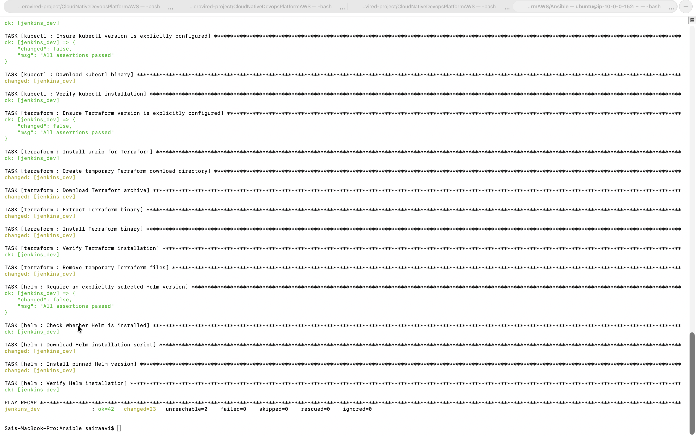

# Ansible — Jenkins CI/CD Controller

## Overview

This directory contains the Ansible configuration for preparing a
Jenkins controller on an Ubuntu Server EC2 instance for the
CloudNativeDevopsPlatformAWS capstone project.

The playbook is designed to be integrated with the Terraform
infrastructure provisioning workflow. Terraform supplies the EC2 address through its dev outputs.

## Repository Structure

- `ansible.cfg` — Ansible configuration.
- `inventories/dev/hosts.yml` — development inventory.
- `inventories/staging/hosts.yml` — staging inventory.
- `inventories/prod/hosts.yml` — production inventory.
- `group_vars/all/main.yml` — shared tool version variables.
- `playbooks/jenkins.yml` — Jenkins controller orchestration playbook.
- `roles/common/` — base packages and system preparation.
- `roles/java/` — Java runtime installation.
- `roles/jenkins/` — Jenkins LTS repository and service.
- `roles/docker/` — Docker Engine and plugins.
- `roles/awscli/` — AWS CLI v2.
- `roles/kubectl/` — Kubernetes command-line client.
- `roles/terraform/` — Terraform CLI.
- `roles/helm/` — Helm CLI.

## Prerequisites

- Ansible Core installed on the control machine.
- Ubuntu Server EC2 instance.
- SSH connectivity from the Ansible control machine.
- An SSH private key with appropriate access to the instance.
- A valid inventory hostname or IP address.
- Privilege escalation permissions on the target.
- Network access to the required package repositories and download endpoints.

## Inventory Configuration

Export CAPSTONE_JENKINS_IP from the current dev Terraform output. The inventory reads this variable:

`Ansible/inventories/dev/hosts.yml`

The inventory currently uses the Ubuntu SSH account. Confirm the
actual AMI and SSH username before running the playbook.

Never commit private keys, passwords, AWS access keys or other
credentials to this repository.

## Version Configuration

The following variables must be set to versions approved by the team:

- `kubectl_version`
- `terraform_version`
- `helm_version`

The kubectl version must be compatible with the EKS cluster version.
The Terraform version should match the version selected for the
team's Terraform code.

## Validation

From the repository root:

```bash
cd Ansible

ansible --version

ansible-inventory \
  -i inventories/dev/hosts.yml \
  --list

ansible-playbook \
  --syntax-check \
  -i inventories/dev/hosts.yml \
  playbooks/jenkins.yml
```

These checks validate the local Ansible configuration, inventory
parsing and playbook syntax. They do not prove that packages can be
installed on a target EC2 instance.

## Deployment Status

**Implemented and verified in dev.** The playbook also configures nginx, CloudWatch Agent and cloudflared. Verify SSH host identity before the first run. Run the [host setup and service-user checks](../Docs/setup-process.md) in steps 19–25. The Docker check can return an empty list with exit code zero. STS should identify the EC2 role. A recorded playbook completed with zero unreachable and failed hosts.



## Security Notes

- Keep SSH host-key checking enabled.
- Restrict inbound SSH access to approved sources.
- Prefer an IAM instance profile for Jenkins AWS API access.
- Avoid storing long-lived AWS credentials on the Jenkins host.
- Membership in the Docker group grants highly privileged host access.
- Do not execute the playbook against production until the inventory,
  variables, access controls and changes have been reviewed.
