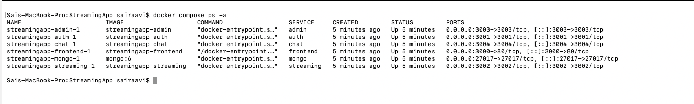
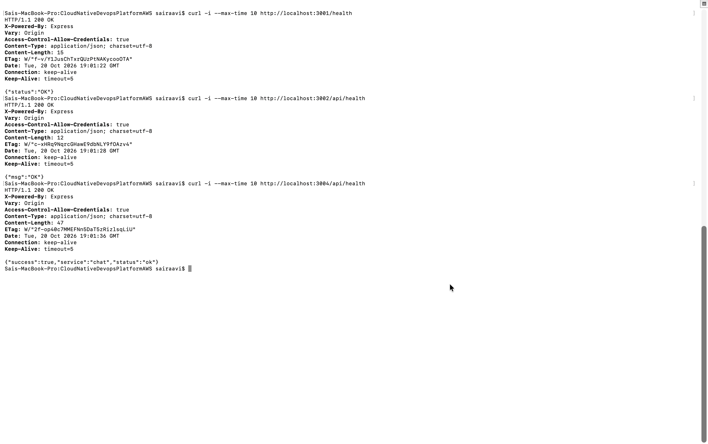

# Start on your laptop

[Setup contents](setup-process.md) · Chapter 1 of 6

Before paying for a cluster, make one request to each service on your own computer. Compose starts the database and five application containers. If login fails here, you can investigate it before adding cloud networking.

Run commands on your Mac from the repository root unless a step names the Jenkins host. Keep the same Bash session so later commands can use the values you set.

## 1. Get the repository and confirm tools

**Mac:** clone only if you do not already have a checkout.

Checkout the implementation branch.

```bash
git clone https://github.com/sairamraavi/CloudNativeDevopsPlatformAWS.git
cd CloudNativeDevopsPlatformAWS
git switch feature/capstone-end-to-end
git status --short
```

Existing contributors can continue on their working branch; Jenkins must use the branch containing the committed changes.

Inspect tool versions.

```bash
git --version
docker version
docker compose version
terraform version
kubectl version --client
helm version --short
ansible --version
python3 --version
aws --version
```

Start Docker Desktop if the Docker server is unavailable. Install missing tools before proceeding. The Jenkinsfile uses Helm 4's `--rollback-on-failure` option.

**Expected:** all tools respond and you know which branch you are using.

## 2. Start an AWS session and choose your domain

Create an SSO profile if needed using `aws configure sso`; use your organization's supplied start URL and permission set. Then set your own values:

Authenticate and verify caller.

```bash
export AWS_PROFILE=streamingapp
export AWS_REGION=ap-south-1
export AWS_DEFAULT_REGION="$AWS_REGION"
export AWS_PAGER=''
export APP_DOMAIN=streaming.example.com
# Use aws login --profile "$AWS_PROFILE" instead for the personal login-based profile.
aws sso login --profile "$AWS_PROFILE"
aws sts get-caller-identity --query '{Account:Account,Arn:Arn}' --output json
```

Replace `streaming.example.com` with a subdomain you control. After confirming the displayed account is the intended account:

Bind the intended account and domain.

```bash
export CAPSTONE_ACCOUNT_ID="$(aws sts get-caller-identity --query Account --output text)"
export TF_VAR_expected_account_id="$CAPSTONE_ACCOUNT_ID"
export TF_VAR_aws_region="$AWS_REGION"
export TF_VAR_application_domain="$APP_DOMAIN"
export TF_VAR_media_allowed_origins="$(printf '["https://%s","http://localhost:3000"]' "$APP_DOMAIN")"
```

These exports apply only to this terminal. Repeat them in a new terminal. `ExpiredToken` means you need to log in again. Do not use Ctrl+Z to cancel Terraform: it suspends the process and can leave a state lock held. Use Ctrl+C and let Terraform exit.

## 3. Validate the application locally

Compose reads [docker-compose.yml](../StreamingApp/docker-compose.yml). Each backend Dockerfile installs its Node dependencies and starts one API. The frontend Dockerfile builds the React app and copies its static files into nginx. Compose publishes nginx on port 3000 so you can open the app from your browser.


**Mac, repository root:** copy the example only if `.env` does not exist.

Initialize private local settings.

```bash
test -f StreamingApp/.env || cp StreamingApp/.env.example StreamingApp/.env
git check-ignore StreamingApp/.env
openssl rand -hex 32 | tr -d '\n' | pbcopy
```

Paste the generated value into `JWT_SECRET` privately. Keep the local frontend URLs on ports 3000–3004 as shown in `.env.example`. Compose supplies the local MongoDB connection. AWS placeholder credentials are not usable credentials; local login can be verified first, and cloud media access is configured through workload IAM roles later.

Build Compose and verify service health.

```bash
docker compose -f StreamingApp/docker-compose.yml config --quiet
docker compose -f StreamingApp/docker-compose.yml up -d --build
docker compose -f StreamingApp/docker-compose.yml ps -a
curl -i --max-time 10 http://localhost:3001/health
curl -i --max-time 10 http://localhost:3002/api/health
curl -i --max-time 10 http://localhost:3003/api/health
curl -i --max-time 10 http://localhost:3004/api/health
docker compose -f StreamingApp/docker-compose.yml exec mongo mongosh --quiet --eval 'db.adminCommand({ ping: 1 })'
```

Open `http://localhost:3000`, register, log in and reload a nested route. Expected: health responses succeed, MongoDB returns `{ ok: 1 }`, and refresh does not return 404. In an early test, signing in worked but refreshing a nested page returned 404. The [frontend nginx configuration](../StreamingApp/frontend/nginx.conf) serves the React entry page for client-side routes. [Before the fix](screenshots/local-validation/03-refresh-404-before.png) · [After the fix](screenshots/local-validation/04-refresh-success-after.png)





**Next:** [Give the project a home in AWS](02-terraform-and-images.md).
