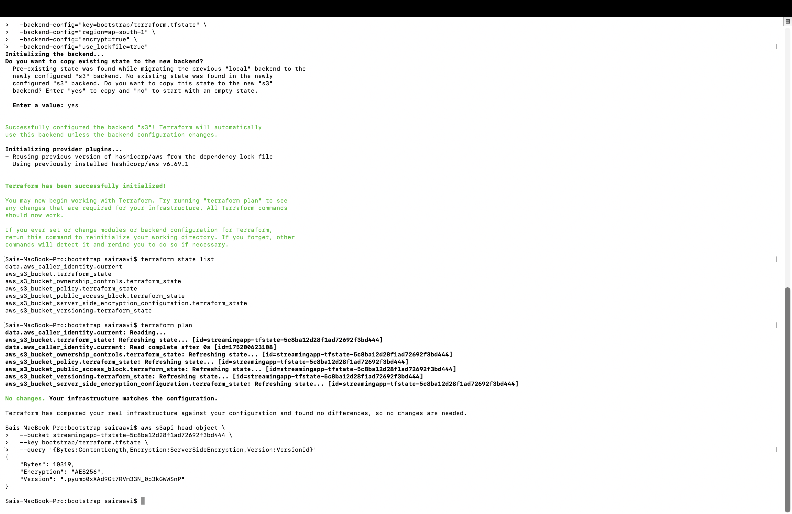
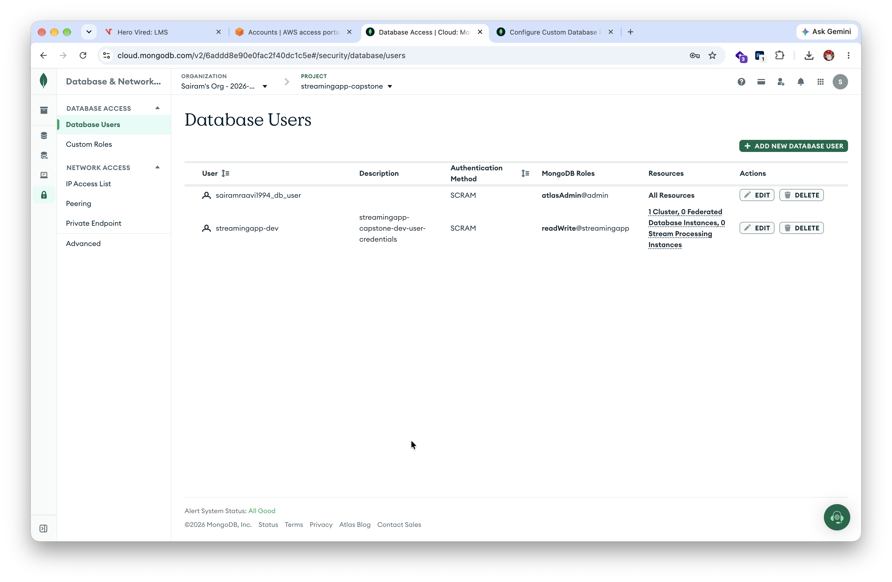
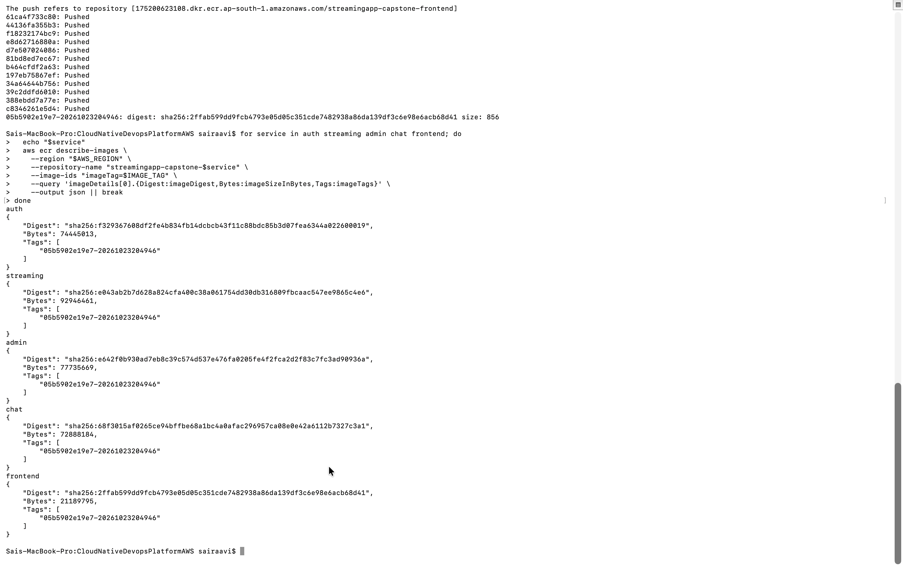

# Give the project a home in AWS

[Setup contents](setup-process.md) · Chapter 2 of 6

Terraform needs somewhere to remember what it created. First create its state bucket. Then create the resources you want to keep across rebuilds: the image registry, media storage, certificate and secret. Finish by pushing images that the cluster will be able to download.

Run commands on your Mac from the repository root unless a step names the Jenkins host. Keep the same Bash session so later commands can use the values you set.

## 4. Create or reconnect Terraform remote state

Think of state as Terraform’s inventory. `init` connects this directory to its backend and installs providers. `plan` shows the proposed changes. `apply` executes a saved plan. Use a fresh checkout for a new account so an old .terraform directory or local state cannot point this run at the lab environment.

The original dev lifecycle uses three independent Terraform roots. Staging adds Terraform/staging-data and Terraform/environments/staging.

| Root | Purpose | Keep between development sessions? |
| --- | --- | --- |
| `Terraform/bootstrap` | State bucket and protection | Yes |
| `Terraform/persistent` | ECR, media, secret metadata, certificate, ALB log bucket | Yes |
| `Terraform/environments/dev` | EKS, networking, IAM, Jenkins and development infrastructure | Can be destroyed and recreated |

**Existing account with a configured backend:** set CAPSTONE_STATE_BUCKET to its bucket name first. Then run the following and keep the existing state bucket. Do not create a replacement or migrate to an empty backend.

Read the existing bootstrap plan.

```bash
terraform -chdir=Terraform/bootstrap init -reconfigure \
  -backend-config="bucket=${CAPSTONE_STATE_BUCKET:?Set the existing state bucket for this account}" \
  -backend-config="key=bootstrap/terraform.tfstate" -backend-config="region=$AWS_REGION" \
  -backend-config=encrypt=true -backend-config=use_lockfile=true
terraform -chdir=Terraform/bootstrap plan -input=false
```

**First deployment in a new account only:** the state bucket must exist before using the S3 backend. Temporarily disable the backend declaration, create the bucket using local state, then migrate that state:

Create and migrate initial state.

```bash
mv Terraform/bootstrap/backend.tf Terraform/bootstrap/backend.tf.disabled
terraform -chdir=Terraform/bootstrap init
terraform -chdir=Terraform/bootstrap validate
terraform -chdir=Terraform/bootstrap plan -input=false -out=bootstrap.tfplan
terraform -chdir=Terraform/bootstrap apply bootstrap.tfplan
export CAPSTONE_STATE_BUCKET="$(terraform -chdir=Terraform/bootstrap output -raw terraform_state_bucket_name)"
mv Terraform/bootstrap/backend.tf.disabled Terraform/bootstrap/backend.tf
terraform -chdir=Terraform/bootstrap init -migrate-state \
  -backend-config="bucket=$CAPSTONE_STATE_BUCKET" \
  -backend-config="key=bootstrap/terraform.tfstate" \
  -backend-config="region=$AWS_REGION" \
  -backend-config="encrypt=true" \
  -backend-config="use_lockfile=true"
```

Answer `yes` to copy the existing local state. Keep any local state backups private. Never commit state or saved plans.

**Both paths:**

Verify the retained state.

```bash
export CAPSTONE_STATE_BUCKET="$(terraform -chdir=Terraform/bootstrap output -raw terraform_state_bucket_name)"
terraform -chdir=Terraform/bootstrap state list
terraform -chdir=Terraform/bootstrap plan -input=false
```

Expected: protected state-bucket resources exist and the follow-up plan reports no changes. Save one screenshot of remote-state verification.



## 5. Provision persistent resources

Plan persistent resources.

```bash
terraform -chdir=Terraform/persistent init \
  -backend-config="bucket=$CAPSTONE_STATE_BUCKET" \
  -backend-config="key=persistent/terraform.tfstate" \
  -backend-config="region=$AWS_REGION" \
  -backend-config="encrypt=true" \
  -backend-config="use_lockfile=true"
terraform -chdir=Terraform/persistent validate
terraform -chdir=Terraform/persistent plan -input=false -out=persistent.tfplan
```

Review the plan, especially account, region, domain and CORS origins. Apply only the intended resources:

Provision persistent resources.

```bash
terraform -chdir=Terraform/persistent apply persistent.tfplan
terraform -chdir=Terraform/persistent output
export CAPSTONE_MEDIA_BUCKET="$(terraform -chdir=Terraform/persistent output -raw media_bucket_name)"
export TF_VAR_media_bucket_arn="$(terraform -chdir=Terraform/persistent output -raw media_bucket_arn)"
export TF_VAR_application_secret_arn="$(terraform -chdir=Terraform/persistent output -raw application_dev_secret_arn)"
export CAPSTONE_CERT_ARN="$(terraform -chdir=Terraform/persistent output -raw application_certificate_arn)"
export CAPSTONE_ALB_LOG_BUCKET="$(terraform -chdir=Terraform/persistent output -raw alb_logs_bucket_name)"
```

Expected: five ECR repositories, private media bucket, secret container, ACM certificate request and ALB access-log bucket. The secret container does **not** yet contain application credentials.

## 6. Validate the HTTPS certificate in Cloudflare

Obtain the DNS validation record.

```bash
terraform -chdir=Terraform/persistent output application_certificate_dns_records
```

In Cloudflare DNS, add each returned CNAME exactly as provided. Set validation records to **DNS only**. Leave these records in place for certificate renewal.

Check certificate issuance.

```bash
aws acm describe-certificate --region "$AWS_REGION" \
  --certificate-arn "$CAPSTONE_CERT_ARN" \
  --query 'Certificate.{Domain:DomainName,Status:Status}' --output json
```

Continue when status is `ISSUED`. Keep the validation record for renewal. You will add a separate application record after the load balancer exists.

## 7. Create Atlas and populate application secrets

1. Create an Atlas project and cluster in the intended region. The original development setup used the free tier, which had no managed backups enabled; this is a development compromise.
2. Create a database user with `readWrite` access to the `streamingapp` database. Store its password privately.
3. Add your current Mac public IPv4 as a `/32` Atlas IP access entry for testing. Do not open access to all addresses.
4. Copy your cluster's SRV hostname from Atlas Connect. Use the password prompt, not a password in shell history:

Test Atlas access.

```bash
export ATLAS_HOST='replace-with-your-cluster.mongodb.net'
docker run --rm -it mongo:8.0 mongosh \
  "mongodb+srv://${ATLAS_HOST}/streamingapp?retryWrites=true&w=majority&authSource=admin" \
  --username streamingapp-dev --password
```

Inside mongosh:

```javascript
db.runCommand({ ping: 1 })
db.getName()
const verificationId = new ObjectId();
db.capstone_connection_checks.insertOne({ _id: verificationId, purpose: 'connectivity-check', checkedAt: new Date() });
db.capstone_connection_checks.findOne({ _id: verificationId });
db.capstone_connection_checks.deleteOne({ _id: verificationId });
exit
```

In AWS Secrets Manager, open `streamingapp-capstone/dev/application` and store two key/value pairs: `MONGO_URI` (complete Atlas URI with URL-encoded credentials and database name) and `JWT_SECRET` (generated random secret). Generate the JWT secret using the clipboard command in step 3. It is a signing secret, not a login token.

Verify a current secret version.

```bash
aws secretsmanager list-secret-version-ids \
  --secret-id "$TF_VAR_application_secret_arn" \
  --query 'Versions[].{Version:VersionId,Stages:VersionStages}' --output table
```

Expected: a version marked `AWSCURRENT`. Screenshot version metadata only. Do not print secret contents.



## 8. Build and publish the first cloud images

The first deployment needs images before Jenkins exists. Use the correct Docker build contexts below. Cloud frontend API URLs are build-time settings; changing a Kubernetes environment variable does not rebuild JavaScript.

Publish five release images.

```bash
export ECR_REGISTRY="${CAPSTONE_ACCOUNT_ID}.dkr.ecr.${AWS_REGION}.amazonaws.com"
export IMAGE_TAG="$(git rev-parse --short=12 HEAD)-$(date -u +%Y%m%d%H%M%S)"
aws ecr get-login-password --region "$AWS_REGION" |
  docker login --username AWS --password-stdin "$ECR_REGISTRY"
docker build --pull --platform linux/amd64 \
  -t "$ECR_REGISTRY/streamingapp-capstone-auth:$IMAGE_TAG" \
  StreamingApp/backend/authService
for service in streaming admin chat; do
  docker build --pull --platform linux/amd64 \
    -f "StreamingApp/backend/${service}Service/Dockerfile" \
    -t "$ECR_REGISTRY/streamingapp-capstone-$service:$IMAGE_TAG" \
    StreamingApp/backend || break
done
docker build --pull --platform linux/amd64 \
  --build-arg REACT_APP_AUTH_API_URL=/api \
  --build-arg REACT_APP_STREAMING_API_URL=/api \
  --build-arg REACT_APP_ADMIN_API_URL=/api/admin \
  --build-arg REACT_APP_CHAT_API_URL=/api/chat \
  -t "$ECR_REGISTRY/streamingapp-capstone-frontend:$IMAGE_TAG" StreamingApp/frontend
docker run --rm --platform linux/amd64 \
  "$ECR_REGISTRY/streamingapp-capstone-frontend:$IMAGE_TAG" nginx -t
for service in auth streaming admin chat frontend; do
  docker push "$ECR_REGISTRY/streamingapp-capstone-$service:$IMAGE_TAG" || break
done
```

Stop if any build/push fails. Record the image tag. **Do not use `/api/streaming` for `REACT_APP_STREAMING_API_URL`**: the client already appends `/streaming`, causing duplicate paths and 404 responses.

Inspect each image and query scans using the `linux/amd64` child digest when its tag points to an OCI image index:

Inspect image platforms.

```bash
docker buildx imagetools inspect "$ECR_REGISTRY/streamingapp-capstone-frontend:$IMAGE_TAG"
```

Copy the actual amd64 digest into the next command, replacing the placeholder:

Read scan findings.

```bash
aws ecr describe-image-scan-findings \
  --repository-name streamingapp-capstone-frontend \
  --image-id imageDigest=REPLACE_WITH_ACTUAL_SHA256_DIGEST \
  --query '{Status:imageScanStatus.status,Counts:imageScanFindings.findingSeverityCounts}'
```

Repeat for all five services. A completed scan with empty counts means no findings reported by that scan, not proof of complete security. The historical frontend release had unresolved findings; do not label it production-approved. Capture the scan summary and any remediation evidence.



**Next:** [Put the application online](03-cluster-and-application.md).
