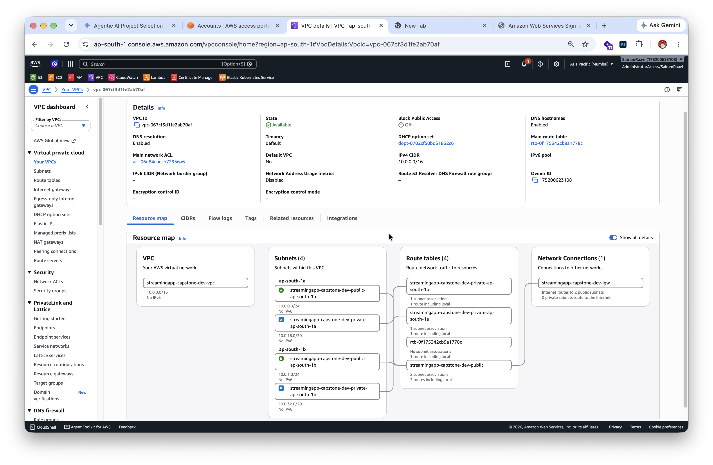
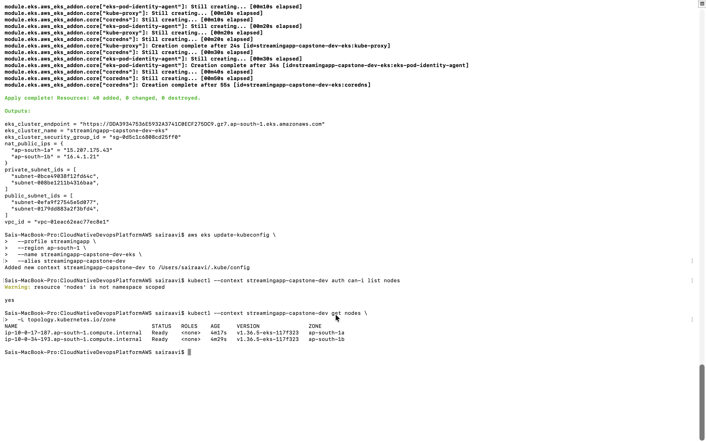
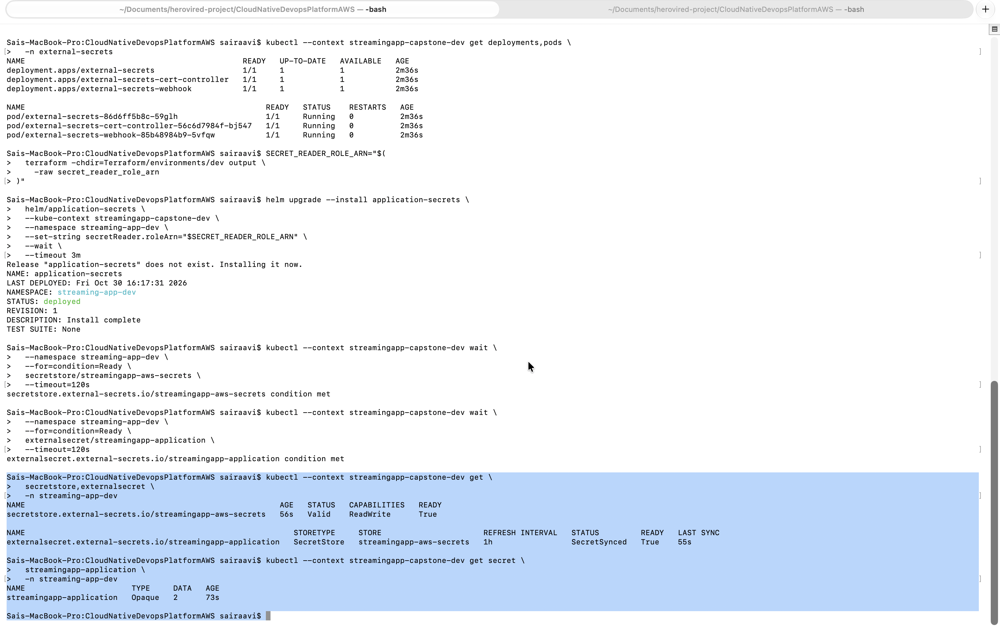
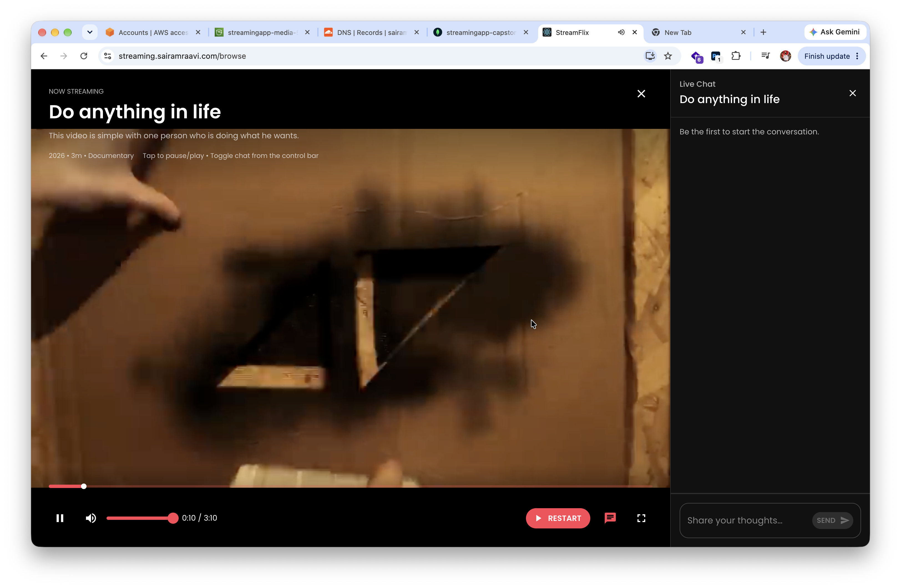

# Put the application online

[Setup contents](setup-process.md) · Chapter 3 of 6

You now have images and a database connection. In this chapter you create the machines, connect the pods to their credentials and route a browser request to the right service. Keep the terminal from the previous chapter open.

Run commands on your Mac from the repository root unless a step names the Jenkins host. Keep the same Bash session so later commands can use the values you set.

## 9. Supply development infrastructure inputs

Create the Jenkins SSH key only if it is absent. Never overwrite an existing key needed for recovery.

Prepare SSH identity and network inputs.

```bash
test -s "$HOME/.ssh/streamingapp-capstone-jenkins" || \
  ssh-keygen -t ed25519 -f "$HOME/.ssh/streamingapp-capstone-jenkins" -C streamingapp-capstone-jenkins
export CAPSTONE_ADMIN_IP="$(curl -4 --fail --silent --show-error https://checkip.amazonaws.com)"
export TF_VAR_eks_public_access_cidrs="$(printf '["%s/32"]' "$CAPSTONE_ADMIN_IP")"
export TF_VAR_jenkins_admin_cidr="${CAPSTONE_ADMIN_IP}/32"
export TF_VAR_jenkins_public_key_path="$HOME/.ssh/streamingapp-capstone-jenkins.pub"
export TF_VAR_availability_zones='["ap-south-1a","ap-south-1b"]'
export TF_VAR_nat_mode=per_az
```

In IAM, locate the **IAM role ARN** of your SSO administrator role (not the STS assumed-role session ARN). In EC2, select a verified Canonical Ubuntu 24.04 amd64 AMI in your region. Set both values:

Set verified EKS inputs.

```bash
export TF_VAR_eks_admin_role_arn='REPLACE_WITH_YOUR_IAM_ROLE_ARN'
export TF_VAR_jenkins_ami_id='REPLACE_WITH_VERIFIED_REGIONAL_UBUNTU_AMI_ID'
```

These placeholders must be replaced before planning. The checked-in EKS configuration requires `per_az` NAT for its private-node design. Choose different AZs only after updating the configuration consistently.

## 10. Create EKS, networking and Jenkins EC2

During the original build we tested networking separately. We reviewed a VPC without NAT, then compared a single NAT gateway with one gateway per availability zone. The final EKS configuration uses private workers with a gateway in each zone. Those two public NAT addresses are what Atlas sees when the app connects. For a rebuild, the dev Terraform root creates this network for you.



Plan dev infrastructure.

```bash
terraform -chdir=Terraform/environments/dev init \
  -backend-config="bucket=$CAPSTONE_STATE_BUCKET" \
  -backend-config="key=environments/dev/terraform.tfstate" \
  -backend-config="region=$AWS_REGION" \
  -backend-config="encrypt=true" \
  -backend-config="use_lockfile=true"
terraform -chdir=Terraform/environments/dev validate
terraform -chdir=Terraform/environments/dev plan -input=false -out=dev.tfplan
```

Review all changes. On recreation, outputs such as public IPs, NAT IPs, VPC IDs and endpoints will change. Save the reviewed plan screenshot, then:

Provision dev and verify nodes.

```bash
terraform -chdir=Terraform/environments/dev apply dev.tfplan
export CAPSTONE_CLUSTER_NAME="$(terraform -chdir=Terraform/environments/dev output -raw eks_cluster_name)"
export CAPSTONE_VPC_ID="$(terraform -chdir=Terraform/environments/dev output -raw vpc_id)"
export CAPSTONE_JENKINS_IP="$(terraform -chdir=Terraform/environments/dev output -raw jenkins_public_ip)"
aws eks update-kubeconfig --region "$AWS_REGION" --name "$CAPSTONE_CLUSTER_NAME" --alias streamingapp-capstone-dev --role-arn "$TF_VAR_eks_admin_role_arn"
kubectl --context streamingapp-capstone-dev auth can-i list nodes
kubectl --context streamingapp-capstone-dev get nodes -L topology.kubernetes.io/zone
kubectl --context streamingapp-capstone-dev get pods -n kube-system
terraform -chdir=Terraform/environments/dev output nat_public_ips
```

Expected: two Ready nodes across two AZs and healthy system pods. Add **both new NAT IPs as `/32` entries in Atlas**; remove obsolete NAT entries after replacement. Capture cluster readiness and Atlas access-list evidence.



## 11. Install External Secrets and synchronize application credentials

Prepare the application namespace.

```bash
kubectl --context streamingapp-capstone-dev create namespace streaming-app-dev --dry-run=client -o yaml |
  kubectl --context streamingapp-capstone-dev apply -f -
helm repo add external-secrets https://charts.external-secrets.io
helm repo update external-secrets
helm search repo external-secrets/external-secrets --versions | head
```

Select a compatible chart version and replace the placeholder below. The session's repository listing included 2.14.0; verify availability before using it.

Install secrets synchronization.

```bash
export ESO_CHART_VERSION=2.14.0
helm upgrade --install external-secrets external-secrets/external-secrets \
  --version "$ESO_CHART_VERSION" --kube-context streamingapp-capstone-dev \
  -n external-secrets --create-namespace --set installCRDs=true --wait --timeout 5m
export SECRET_READER_ROLE_ARN="$(terraform -chdir=Terraform/environments/dev output -raw secret_reader_role_arn)"
helm upgrade --install application-secrets helm/application-secrets \
  --kube-context streamingapp-capstone-dev -n streaming-app-dev \
  --set-string secretReader.roleArn="$SECRET_READER_ROLE_ARN" \
  --set-string awsRegion="$AWS_REGION"
kubectl --context streamingapp-capstone-dev get secretstore,externalsecret -n streaming-app-dev
kubectl --context streamingapp-capstone-dev wait --for=condition=Ready \
  externalsecret/streamingapp-application -n streaming-app-dev --timeout=180s
```

Continue only after synchronization succeeds. Save readiness evidence without decoding the Kubernetes Secret.



## 12. Install the AWS Load Balancer Controller

Install the ALB controller.

```bash
helm repo add eks https://aws.github.io/eks-charts
helm repo update eks
export CAPSTONE_LBC_ROLE_ARN="$(terraform -chdir=Terraform/environments/dev output -raw load_balancer_controller_role_arn)"
helm upgrade --install aws-load-balancer-controller eks/aws-load-balancer-controller \
  --version 1.14.1 --kube-context streamingapp-capstone-dev -n kube-system \
  --set-string clusterName="$CAPSTONE_CLUSTER_NAME" \
  --set-string region="$AWS_REGION" --set-string vpcId="$CAPSTONE_VPC_ID" \
  --set serviceAccount.create=true --set-string serviceAccount.name=aws-load-balancer-controller \
  --set-string "serviceAccount.annotations.eks\.amazonaws\.com/role-arn=$CAPSTONE_LBC_ROLE_ARN" \
  --set replicaCount=2 --wait --timeout 5m
kubectl --context streamingapp-capstone-dev get deployment aws-load-balancer-controller -n kube-system
kubectl --context streamingapp-capstone-dev get ingressclass alb
```

Expected: controller 2/2 Ready and ingress class `alb`. The chart version matches the checked-in v2.14.1 IAM policy.

## 13. Install the application with this deployment's values

Deploy application with Helm.

```bash
export CAPSTONE_ADMIN_MEDIA_ROLE="$(terraform -chdir=Terraform/environments/dev output -json media_workload_role_arns | python3 -c 'import json,sys; print(json.load(sys.stdin)["admin"])')"
export CAPSTONE_STREAMING_MEDIA_ROLE="$(terraform -chdir=Terraform/environments/dev output -json media_workload_role_arns | python3 -c 'import json,sys; print(json.load(sys.stdin)["streaming"])')"
helm lint helm/streamingapp --set-string image.registry="$ECR_REGISTRY" --set-string image.tag="$IMAGE_TAG" --set-string frontend.tag="$IMAGE_TAG" --set-string app.s3Bucket="$CAPSTONE_MEDIA_BUCKET"
helm upgrade --install streamingapp helm/streamingapp \
  --kube-context streamingapp-capstone-dev -n streaming-app-dev \
  --set-string image.registry="$ECR_REGISTRY" --set-string image.tag="$IMAGE_TAG" \
  --set-string frontend.tag="$IMAGE_TAG" \
  --set-string app.clientUrls="https://$APP_DOMAIN" \
  --set-string app.streamingPublicUrl="https://$APP_DOMAIN" \
  --set-string app.awsRegion="$AWS_REGION" --set-string app.s3Bucket="$CAPSTONE_MEDIA_BUCKET" \
  --set-string services.admin.roleArn="$CAPSTONE_ADMIN_MEDIA_ROLE" \
  --set-string services.streaming.roleArn="$CAPSTONE_STREAMING_MEDIA_ROLE" \
  --set ingress.enabled=true --set-string ingress.host="$APP_DOMAIN" \
  --set-string ingress.certificateArn="$CAPSTONE_CERT_ARN" \
  --wait --timeout 10m
kubectl --context streamingapp-capstone-dev get deployments,pods,ingress -n streaming-app-dev
```

Expected: all five deployments ready and an ALB hostname appears on the ingress. If pods fail, inspect their events/logs before proceeding; common causes are Atlas NAT entries, secret synchronization or incorrect image registry/tag.

## 14. Point DNS at the ALB and test the public application

Inspect ingress hostname.

```bash
kubectl --context streamingapp-capstone-dev get ingress streamingapp -n streaming-app-dev \
  -o jsonpath='{.status.loadBalancer.ingress[0].hostname}{"\n"}'
```

Create your application's Cloudflare CNAME pointing to that hostname, **DNS only** for the initial ACM/ALB validation. Do not replace the certificate validation CNAME.

Verify DNS and HTTPS.

```bash
dig +short CNAME "$APP_DOMAIN"
curl --silent --show-error --max-time 20 -o /dev/null -D - "http://$APP_DOMAIN/"
curl --silent --show-error --max-time 20 -o /dev/null -D - "https://$APP_DOMAIN/"
```

Expected: HTTP redirects to HTTPS; HTTPS returns 200. Register/login, refresh `/browse`, upload and play a small video using an authorized admin, and test chat with two users. Confirm normal users cannot access admin APIs. Do not promote arbitrary users to admin without reviewing the application's authorization implementation.

Capture only major proof: HTTPS, login/API routing, S3 upload, playback, two-user chat and admin rejection. API requests should use your public domain, not localhost.



**Next:** [See when the application needs attention](04-monitoring.md).
