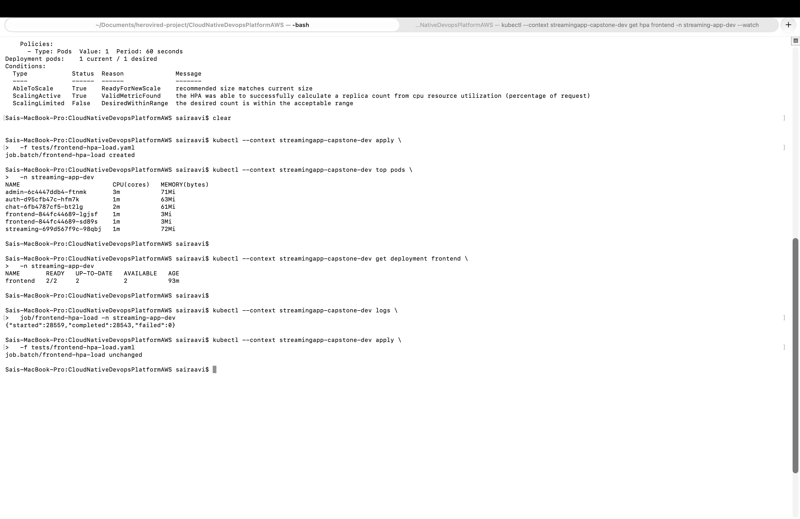
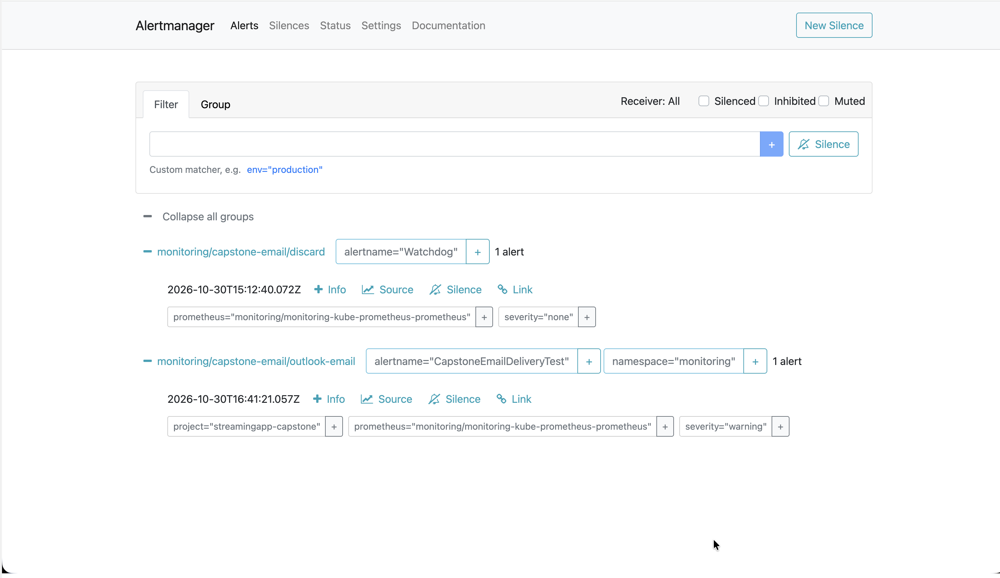
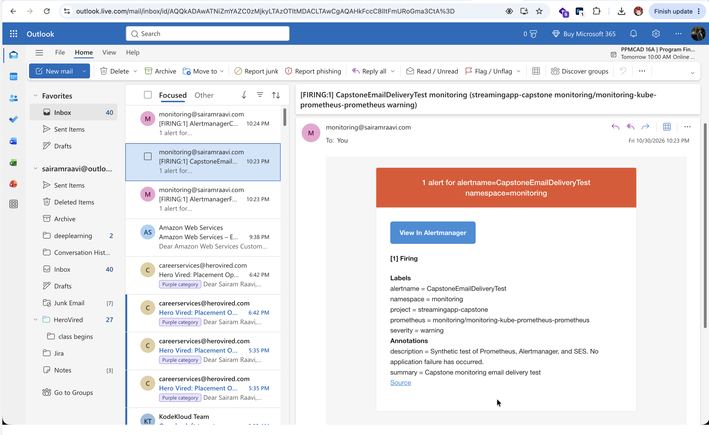

# See when the application needs attention

[Setup contents](setup-process.md) · Chapter 4 of 6

First watch Kubernetes change the number of application pods. Then install the tools that record those measurements and notify you. The test email at the end lets you check the whole alert path without breaking the application.

Run commands on your Mac from the repository root unless a step names the Jenkins host. Keep the same Bash session so later commands can use the values you set.

## 15. Verify scaling and persistent-storage prerequisites

The current Terraform root includes metrics-server and EBS CSI resources; do not install duplicate copies manually.

Verify metrics and create storage class.

```bash
kubectl --context streamingapp-capstone-dev top nodes
kubectl --context streamingapp-capstone-dev top pods -n streaming-app-dev
kubectl --context streamingapp-capstone-dev get hpa -n streaming-app-dev
kubectl --context streamingapp-capstone-dev get csidriver ebs.csi.aws.com
kubectl --context streamingapp-capstone-dev apply -f Monitoring/storage/gp3-encrypted.yaml
kubectl --context streamingapp-capstone-dev get storageclass capstone-gp3-encrypted
```

To reproduce the bounded frontend HPA test:

Start bounded HPA load.

```bash
kubectl --context streamingapp-capstone-dev apply -f tests/frontend-hpa-load.yaml
kubectl --context streamingapp-capstone-dev get hpa frontend -n streaming-app-dev --watch
```

Ctrl+C ends the watch. After collecting scale-up evidence:

Remove load and inspect HPA.

```bash
kubectl --context streamingapp-capstone-dev logs job/frontend-hpa-load -n streaming-app-dev
kubectl --context streamingapp-capstone-dev delete job frontend-hpa-load -n streaming-app-dev --ignore-not-found
kubectl --context streamingapp-capstone-dev get hpa frontend -n streaming-app-dev
```

Allow the configured five-minute downscale stabilization period. Capture scale-down once it returns to one replica. HPA scales pods; Cluster Autoscaler scales worker nodes.



## 16. Install Cluster Autoscaler

Install autoscaler.

```bash
export CAPSTONE_AUTOSCALER_ROLE="$(terraform -chdir=Terraform/environments/dev output -raw autoscaler_role_arn)"
helm repo add autoscaler https://kubernetes.github.io/autoscaler
helm repo update autoscaler
helm upgrade --install cluster-autoscaler autoscaler/cluster-autoscaler \
  --version 9.59.0 --kube-context streamingapp-capstone-dev -n kube-system \
  -f Monitoring/cluster-autoscaler-values.yaml \
  --set-string awsRegion="$AWS_REGION" --set-string autoDiscovery.clusterName="$CAPSTONE_CLUSTER_NAME" \
  --set-string "rbac.serviceAccount.annotations.eks\.amazonaws\.com/role-arn=$CAPSTONE_AUTOSCALER_ROLE" \
  --set-string 'rbac.serviceAccount.annotations.eks\.amazonaws\.com/sts-regional-endpoints=true' \
  --wait --timeout 5m
kubectl --context streamingapp-capstone-dev logs deployment/cluster-autoscaler -n kube-system --tail=50
```

The values pin the autoscaler image to Kubernetes minor 1.36; do not rely on the chart's default app version. Annotations must render as YAML strings. Verify discovery and absence of access-denied errors before claiming autoscaling is operational.

## 17. Prepare monitoring passwords and install Prometheus/Grafana

Create the namespace, then create the Grafana admin Secret using a temporary private directory. These commands do not print the password:

Install monitoring.

```bash
kubectl --context streamingapp-capstone-dev create namespace monitoring --dry-run=client -o yaml |
  kubectl --context streamingapp-capstone-dev apply -f -
CAPSTONE_SECRET_DIR="$(mktemp -d)"
chmod 700 "$CAPSTONE_SECRET_DIR"
printf admin > "$CAPSTONE_SECRET_DIR/admin-user"
read -r -s -p 'Choose Grafana password: ' CAPSTONE_GRAFANA_PASSWORD
printf '\n'
printf '%s' "$CAPSTONE_GRAFANA_PASSWORD" > "$CAPSTONE_SECRET_DIR/admin-password"
chmod 600 "$CAPSTONE_SECRET_DIR/"*
kubectl --context streamingapp-capstone-dev create secret generic grafana-admin -n monitoring \
  --from-file=admin-user="$CAPSTONE_SECRET_DIR/admin-user" \
  --from-file=admin-password="$CAPSTONE_SECRET_DIR/admin-password" \
  --dry-run=client -o yaml | kubectl --context streamingapp-capstone-dev apply -f -
unset CAPSTONE_GRAFANA_PASSWORD
rm -r "$CAPSTONE_SECRET_DIR"
helm repo add prometheus-community https://prometheus-community.github.io/helm-charts
helm repo update prometheus-community
helm upgrade --install monitoring prometheus-community/kube-prometheus-stack \
  --version 92.16.1 --kube-context streamingapp-capstone-dev -n monitoring \
  -f Monitoring/kube-prometheus-stack-values.yaml \
  --set 'alertmanager.alertmanagerSpec.alertmanagerConfiguration=null' \
  --set 'prometheus.prometheusSpec.additionalScrapeConfigs=[]' \
  --wait --timeout 10m
kubectl --context streamingapp-capstone-dev get pods,pvc -n monitoring
```

The two initial overrides avoid referencing an email configuration that is not created yet or an old Jenkins private IP. Configure them in later steps. Expected: running pods and three Bound PVCs.

Open separate Mac terminals and keep each port-forward running:

Open a local monitoring tunnel.

```bash
kubectl --context streamingapp-capstone-dev port-forward -n monitoring service/monitoring-grafana 3000:80
```

Open a local monitoring tunnel.

```bash
kubectl --context streamingapp-capstone-dev port-forward -n monitoring service/monitoring-kube-prometheus-prometheus 9090:9090
```

Use `http://localhost:3000` for Grafana (choose 3005:80 if the local app uses 3000) and `http://localhost:9090` for Prometheus. Log in with the Grafana password just chosen. Open Kubernetes cluster/namespace resource dashboards. In Prometheus, run `up` and `up == 0`; inspect Targets. Save dashboard and target-health screenshots. Metrics-server is not a replacement for Prometheus historical monitoring.

## 18. Configure email alerts through SES

1. In SES in the same region, verify a sender domain using its DNS records and verify your recipient email if the account remains in the sandbox.
2. Create SES SMTP credentials and restrict their sending permissions. These are **SMTP credentials**, not your Outlook password.
3. Edit `Monitoring/alertmanager-email.yaml`: use your recipient, verified sender and regional SMTP hostname. Leave the `__SES_SMTP_USERNAME__` marker until rendering. `authUsername` is a string; `authPassword` is a Secret reference.
4. Create `monitoring/alertmanager-ses-smtp` with `username` and `password` keys privately. Use the temporary-file pattern from step 17, substituting these two filenames and Secret name. Do not commit the values.
Use this command sequence for step 4:

Store SMTP credentials privately.

```bash
CAPSTONE_SMTP_DIR="$(mktemp -d)"
chmod 700 "$CAPSTONE_SMTP_DIR"
read -r -s -p 'SES SMTP username: ' CAPSTONE_SMTP_USERNAME
printf '\n'
read -r -s -p 'SES SMTP password: ' CAPSTONE_SMTP_PASSWORD
printf '\n'
printf '%s' "$CAPSTONE_SMTP_USERNAME" > "$CAPSTONE_SMTP_DIR/username"
printf '%s' "$CAPSTONE_SMTP_PASSWORD" > "$CAPSTONE_SMTP_DIR/password"
chmod 600 "$CAPSTONE_SMTP_DIR/"*
kubectl --context streamingapp-capstone-dev create secret generic alertmanager-ses-smtp -n monitoring \
  --from-file=username="$CAPSTONE_SMTP_DIR/username" --from-file=password="$CAPSTONE_SMTP_DIR/password" \
  --dry-run=client -o yaml | kubectl --context streamingapp-capstone-dev apply -f -
unset CAPSTONE_SMTP_USERNAME CAPSTONE_SMTP_PASSWORD
rm -r "$CAPSTONE_SMTP_DIR"
```

5. Render the username from the Secret into the configuration and apply it without displaying credentials:

Configure routing and fire the test.

```bash
python3 - <<'PYSES'
import base64, json, pathlib, subprocess
base = ['kubectl', '--context', 'streamingapp-capstone-dev']
s = json.loads(subprocess.check_output(base + ['get', 'secret', 'alertmanager-ses-smtp', '-n', 'monitoring', '-o', 'json']))
u = base64.b64decode(s['data']['username']).decode()
text = pathlib.Path('Monitoring/alertmanager-email.yaml').read_text()
text = text.replace('"__SES_SMTP_USERNAME__"', json.dumps(u))
subprocess.run(base + ['apply', '-f', '-'], input=text, text=True, check=True)
PYSES
helm upgrade monitoring prometheus-community/kube-prometheus-stack \
  --version 92.16.1 --kube-context streamingapp-capstone-dev -n monitoring \
  --reuse-values --set-string alertmanager.alertmanagerSpec.alertmanagerConfiguration.name=capstone-email \
  --wait --timeout 10m
kubectl patch --local -f tests/monitoring-email-alert.yaml --type=json -p='[{"op":"replace","path":"/spec/groups/0/rules/0/expr","value":"vector(1) == 1"}]' -o yaml | kubectl --context streamingapp-capstone-dev -n monitoring apply -f -
```

Wait for the test alert to fire and arrive in the inbox. Confirm delivery rather than just a firing rule. Restore the inactive rule, wait for the resolved email, then remove the test rule:

Resolve and remove the test rule.

```bash
kubectl --context streamingapp-capstone-dev -n monitoring apply -f tests/monitoring-email-alert.yaml
```

Wait until the resolved notification arrives. Then remove the test rule:

```bash
kubectl --context streamingapp-capstone-dev -n monitoring delete -f tests/monitoring-email-alert.yaml
```

Capture firing and resolved emails. SES usage is billable subject to account allowances; do not assume it is free.





**Next:** [Turn a Git push into a deployment](05-jenkins-and-logs.md).
