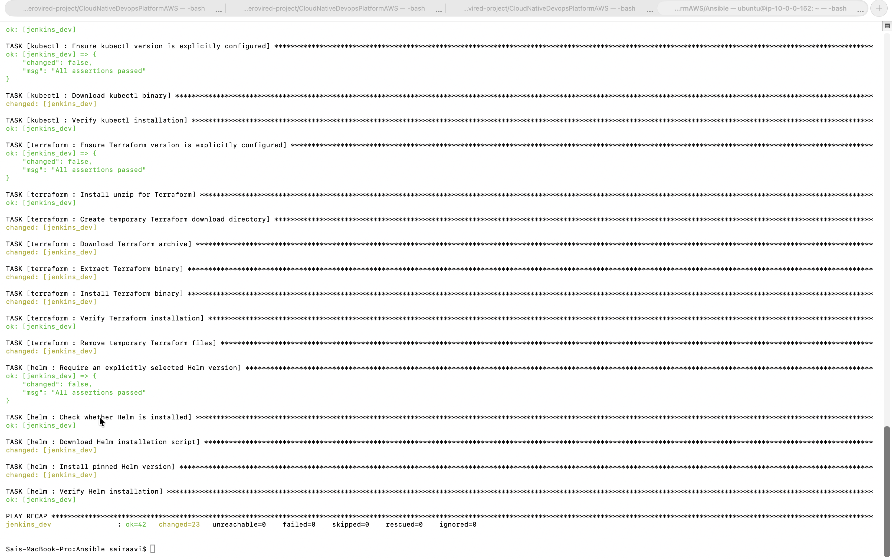
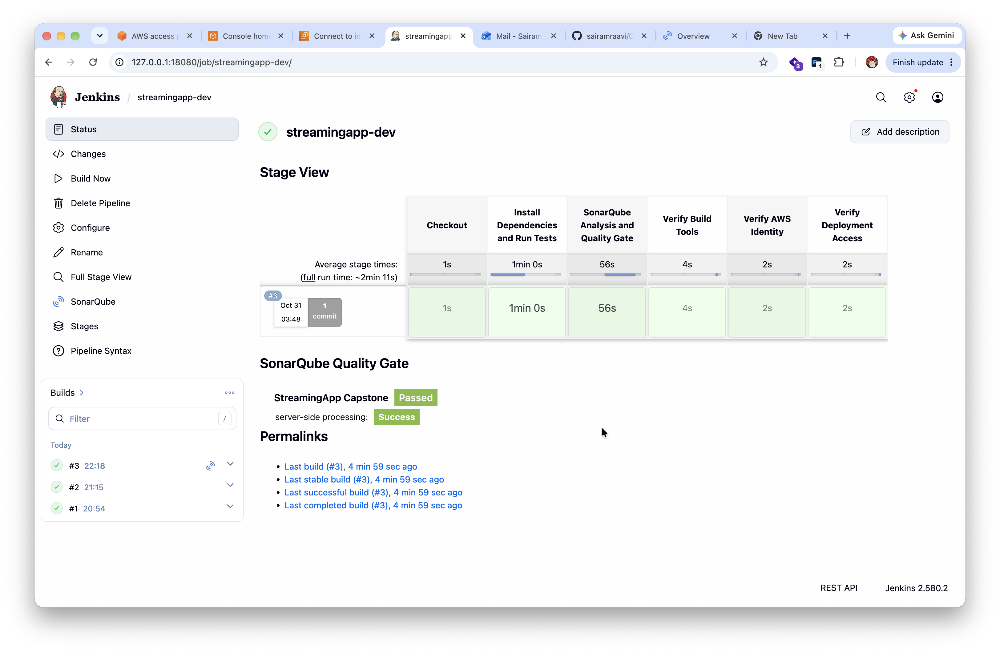
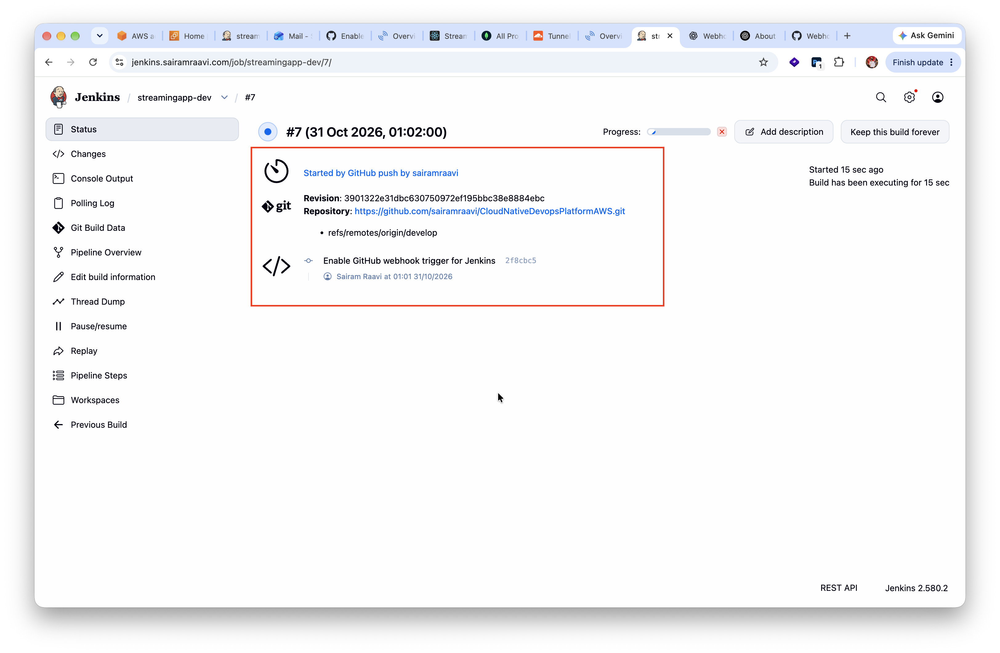
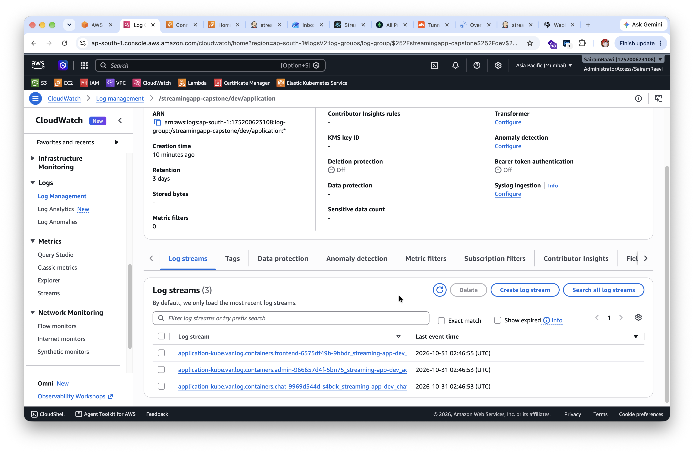
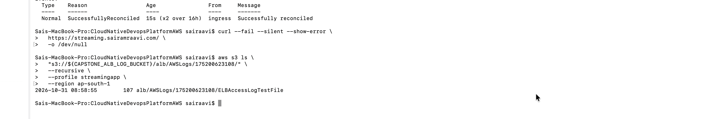

# Turn a Git push into a deployment

[Setup contents](setup-process.md) · Chapter 5 of 6

Terraform created the Jenkins machine. Ansible installs the tools on it. Once a manual build works, connect GitHub and verify that a push starts the same job. Finish by following a real request into the logs.

Run commands on your Mac from the repository root unless a step names the Jenkins host. Keep the same Bash session so later commands can use the values you set.

## 19. Configure the Jenkins host through Ansible

**Mac, repository root:** refresh the current EC2 IP rather than reusing an earlier session's address.

Connect to the current Jenkins EC2.

```bash
export CAPSTONE_JENKINS_IP="$(terraform -chdir=Terraform/environments/dev output -raw jenkins_public_ip)"
ssh -i "$HOME/.ssh/streamingapp-capstone-jenkins" "ubuntu@$CAPSTONE_JENKINS_IP"
```

Confirm the host fingerprint using trusted EC2 information before accepting a new key. Exit back to the Mac. Customize `Ansible/roles/nginx/defaults/main.yml` for your Jenkins and SonarQube hostnames. Review version pins in `Ansible/group_vars/all/main.yml`.

Configure EC2 and verify Jenkins identity.

```bash
cd Ansible
ansible jenkins -m ansible.builtin.ping
ansible-playbook playbooks/jenkins.yml -e @group_vars/all/main.yml --syntax-check
ansible-playbook playbooks/jenkins.yml -e @group_vars/all/main.yml --skip-tags cloudflared
ansible jenkins -b --become-user=jenkins -m ansible.builtin.command -a 'docker ps'
ansible jenkins -b --become-user=jenkins -m ansible.builtin.command -a 'aws sts get-caller-identity --region ap-south-1'
cd ..
```

Cloudflared is deliberately deferred until a valid private token exists. Confirm the AWS identity is the Jenkins instance role. The host should not use copied SSO/static AWS credentials.

Open Jenkins through an SSH tunnel **from the Mac**, not inside EC2:

Leave this terminal open. Use a second terminal on the Mac for later commands.

```bash
ssh -i "$HOME/.ssh/streamingapp-capstone-jenkins" -N \
  -L 18080:127.0.0.1:8080 -L 19000:127.0.0.1:9000 "ubuntu@$CAPSTONE_JENKINS_IP"
```

Visit `http://127.0.0.1:18080`. For a fresh installation, obtain the initial admin password privately on EC2 using `sudo cat /var/lib/jenkins/secrets/initialAdminPassword`, finish the wizard and create an administrator. Never screenshot that password.



## 20. Give Jenkins its Kubernetes context

Configure Jenkins EKS access.

```bash
cd Ansible
ansible jenkins -b --become-user=jenkins -m ansible.builtin.command \
  -a 'aws eks update-kubeconfig --region ap-south-1 --name streamingapp-capstone-dev-eks --alias streamingapp-capstone-dev --kubeconfig /var/lib/jenkins/.kube/config'
ansible jenkins -b --become-user=jenkins -m ansible.builtin.command \
  -a 'kubectl --kubeconfig /var/lib/jenkins/.kube/config --context streamingapp-capstone-dev auth can-i patch deployments -n streaming-app-dev'
ansible jenkins -b --become-user=jenkins -m ansible.builtin.command \
  -a 'kubectl --kubeconfig /var/lib/jenkins/.kube/config --context streamingapp-capstone-dev auth can-i delete nodes'
cd ..
```

Expected: namespace deployment check says `yes`; node deletion says `no` (Ansible reports a nonzero result for this intentional negative test). The Terraform access policy and security-group rule must exist first. Capture this scoped-access proof.

## 21. Start SonarQube and configure the quality gate

Copy `Monitoring/sonarqube/compose.yaml` to `/opt/capstone-sonarqube/compose.yaml` on Jenkins EC2. Create a private `.env` there containing `POSTGRES_IMAGE`, `SONAR_IMAGE` and a strong `SONAR_DB_PASSWORD`. Use compatible, verified image versions/digests, not arbitrary latest tags. Preserve the same database major version when restoring an existing dump.

**Mac, repository root:** transfer the checked-in Compose file:

Transfer the Compose definition.

```bash
scp -i "$HOME/.ssh/streamingapp-capstone-jenkins" Monitoring/sonarqube/compose.yaml "ubuntu@$CAPSTONE_JENKINS_IP:/tmp/capstone-sonarqube-compose.yaml"
```

**Jenkins EC2:** create the directory and install the file:

On the Jenkins host, prepare the SonarQube directory.

```bash
sudo install -d -m 750 /opt/capstone-sonarqube
sudo install -m 640 /tmp/capstone-sonarqube-compose.yaml /opt/capstone-sonarqube/compose.yaml
sudo test -e /opt/capstone-sonarqube/.env || sudo install -m 600 /dev/null /opt/capstone-sonarqube/.env
sudo nano /opt/capstone-sonarqube/.env
```

Use the following format in the editor. Replace the placeholders with the selected image references and a password; do not run this as shell code.

```dotenv
POSTGRES_IMAGE=postgres@sha256:YOUR_VERIFIED_COMPATIBLE_DIGEST
SONAR_IMAGE=sonarqube@sha256:YOUR_VERIFIED_COMPATIBLE_DIGEST
SONAR_DB_PASSWORD=YOUR_PRIVATE_RANDOM_PASSWORD
```

**Jenkins EC2:**

On the Jenkins host, start SonarQube and verify status.

```bash
sudo chmod 600 /opt/capstone-sonarqube/.env
sudo sysctl -w vm.max_map_count=1048576
printf 'vm.max_map_count=1048576\n' | sudo tee /etc/sysctl.d/99-sonarqube.conf
sudo docker compose --project-directory /opt/capstone-sonarqube \
  --env-file /opt/capstone-sonarqube/.env -f /opt/capstone-sonarqube/compose.yaml up -d
curl --fail --silent --show-error http://127.0.0.1:9000/api/system/status
```

Wait for `UP`; a connection reset during startup is not itself proof of permanent failure. Use Compose logs if it does not become ready. The original compose limits require sufficient host memory.

Open `http://127.0.0.1:19000` through the Mac tunnel. Change the initial password, create project key `streamingapp-capstone` (matching `sonar-project.properties`), generate a project analysis token, and store it as a Jenkins Secret Text credential. In Jenkins install/configure the SonarQube Scanner integration:

- Server configuration name: `capstone-sonarqube`; URL from Jenkins: `http://127.0.0.1:9000`.
- Scanner tool name: `capstone-sonar-scanner`.
- Bind the token credential to the SonarQube server configuration.

The current project properties make the scanner wait for its quality gate. A restored SonarQube instance already containing the project does not need a duplicate project.



## 22. Configure and run the Jenkins pipeline

The Jenkinsfile compares the instance-role account against the configured dev cluster ARN, derives the ECR registry from the account and region, and reads the application hostname from the deployed Ingress. The job expects the dev cluster and namespace names used by this guide.

Install the Pipeline, Git, GitHub, SonarQube Scanner and Prometheus metrics plugins as required by the Jenkinsfile and monitoring. Create a Pipeline job:

1. Name: `streamingapp-dev`.
2. Definition: **Pipeline script from SCM**, SCM: Git.
3. Repository: your repository URL; use a read credential if private.
4. Branch specifier: the branch containing the Jenkinsfile, e.g. `*/develop` or `*/feature/capstone-end-to-end`.
5. Script path: `Jenkinsfile`.
6. Save and run the job. With DEPLOY_TO_DEV enabled, the root Jenkinsfile automatically promotes after dev verification. Complete the [staging preparation](delivery.md) first for an end-to-end run.

The first manual application installation in step 13 is required: the current pipeline uses `helm upgrade`, not first-install provisioning. Expected sequence: checkout → tests → SonarQube gate → tool/identity/access checks → build → ECR push → Helm upgrade → rollout/HTTPS checks. Save a successful full pipeline screenshot and quality-gate evidence. Do not treat only the initial verification stages as a completed deployment pipeline.

## 23. Configure Cloudflare Tunnel and the GitHub webhook

Create a Cloudflare Tunnel for this Jenkins host. Store its connector token privately at `/etc/cloudflared/token`, owned by root with mode 600. Do not paste token values into Git, screenshots, or chat. The role can alternatively receive `vault_cloudflared_tunnel_token` from an encrypted Ansible Vault file.

In Cloudflare configure public hostnames:

| Hostname | Origin on EC2 |
| --- | --- |
| Your Jenkins hostname | `http://127.0.0.1:8081` |
| Your SonarQube hostname | `http://127.0.0.1:8082` |

The two nginx listeners are loopback-only. Jenkins metrics use the **private EC2 IP** on port 8082; this is a different listening address from SonarQube's loopback port.

**Mac:**

Configure the tunnel service.

```bash
cd Ansible
ansible-playbook playbooks/jenkins.yml -e @group_vars/all/main.yml --tags cloudflared
cd ..
```

Verify the tunnel is healthy and both URLs load. Restrict dashboard access through Cloudflare Access and application authorization. Configure the exact `/github-webhook/` path so GitHub can reach it without an interactive Access login; retain POST-only handling and configure webhook secret verification in Jenkins/GitHub. Do not bypass access control for the entire hostname.

In GitHub repository Settings → Webhooks add `https://YOUR_JENKINS_HOST/github-webhook/`, JSON content type, SSL verification enabled and push events. Confirm delivery succeeds, then push an intended commit and verify an automatic successful build. Save webhook delivery and automatically triggered build evidence.



## 24. Connect Jenkins metrics to Prometheus

Verify the Prometheus plugin endpoint on **Jenkins EC2**:

On the Jenkins host, verify local metrics and nginx.

```bash
curl --fail --silent --show-error http://127.0.0.1:8080/prometheus/ | head
sudo nginx -t
```

Get the current private address from Terraform on the Mac:

Read current Jenkins private IP.

```bash
CAPSTONE_JENKINS_PRIVATE_IP="$(terraform -chdir=Terraform/environments/dev output -raw jenkins_private_ip)"
```

Use the current Jenkins private IP plus port 8082 as the scrape target. Ensure the Terraform security-group rule permits the intended monitoring source. Reapply the complete values file now that `capstone-email` exists:

Update the Jenkins scrape target.

```bash
helm upgrade monitoring prometheus-community/kube-prometheus-stack \
  --version 92.16.1 --kube-context streamingapp-capstone-dev -n monitoring \
  -f Monitoring/kube-prometheus-stack-values.yaml \
  --set-string "prometheus.prometheusSpec.additionalScrapeConfigs[0].static_configs[0].targets[0]=$CAPSTONE_JENKINS_PRIVATE_IP:8082" --wait --timeout 10m
```

Query `up{job="jenkins"}` in Prometheus; expected value is 1. Import `Monitoring/dashboards/jenkins-monitoring.json` into Grafana and select the Prometheus data source. Capture a populated dashboard, not an empty one.

## 25. Verify CloudWatch application and Jenkins logs

Terraform creates log groups and IAM access. Ansible installs/configures the Jenkins CloudWatch agent. For application logs, install Fluent Bit with the role from this deployment:

Inspect logging role and chart.

```bash
export CAPSTONE_LOG_ROLE="$(terraform -chdir=Terraform/environments/dev output -raw application_logs_role_arn)"
helm repo add fluent https://fluent.github.io/helm-charts
helm repo update fluent
helm search repo fluent/fluent-bit --versions | head
```

Select and record a compatible chart version, replacing the placeholder:

Install log collector and inspect delivery.

```bash
export FLUENT_BIT_CHART_VERSION='REPLACE_WITH_SELECTED_VERSION'
helm upgrade --install fluent-bit fluent/fluent-bit \
  --version "$FLUENT_BIT_CHART_VERSION" --kube-context streamingapp-capstone-dev \
  -n monitoring -f Monitoring/cloudwatch/fluent-bit-values.yaml \
  --set-string "serviceAccount.annotations.eks\.amazonaws\.com/role-arn=$CAPSTONE_LOG_ROLE" \
  --wait --timeout 5m
aws logs tail /streamingapp-capstone/dev/application --since 1h --format short
aws logs tail /streamingapp-capstone/dev/jenkins --since 1h --format short
```

The Fluent Bit input/output config and Jenkins agent JSON currently specify the dev namespace and Mumbai region; change them together if deploying elsewhere. Confirm the logging IAM trust matches `monitoring/fluent-bit` before installing.

If Jenkins logs are empty, on **EC2**, inspect `sudo journalctl -u jenkins.service` and `/opt/aws/amazon-cloudwatch-agent/logs/amazon-cloudwatch-agent.log`. The latter path does not exist on your Mac. Verify newly emitted Jenkins messages arrive; an active agent alone does not prove delivery. Capture application and Jenkins log records (historical screenshots 67 and 68).



## 26. Enable ALB access logs

The persistent root creates a private log bucket with a delivery policy and three-day expiration. Preserve the existing idle-timeout attribute while adding access-log attributes:

Enable ALB request logging.

```bash
helm upgrade streamingapp helm/streamingapp \
  --kube-context streamingapp-capstone-dev -n streaming-app-dev --reuse-values \
  --set-string "ingress.loadBalancerAttributes=idle_timeout.timeout_seconds=120\,access_logs.s3.enabled=true\,access_logs.s3.bucket=$CAPSTONE_ALB_LOG_BUCKET\,access_logs.s3.prefix=alb" \
  --wait --timeout 10m
curl --fail --silent --show-error -o /dev/null "https://$APP_DOMAIN/"
aws s3 ls "s3://$CAPSTONE_ALB_LOG_BUCKET/alb/AWSLogs/$CAPSTONE_ACCOUNT_ID/" --recursive
```

Delivery is asynchronous. Verify actual log objects after allowing time, not just the bucket existence or test file. Capture delivered access-log evidence (historical screenshot 69).



**Next:** [Save the working setup and bring it back](06-backup-and-rebuild.md).
