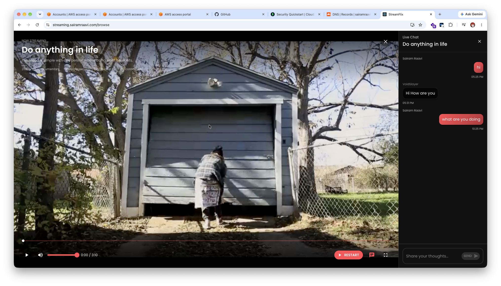

# Save the working setup and bring it back

[Setup contents](setup-process.md) · Chapter 6 of 6

Do this when you are ready to retire dev. Save Jenkins and SonarQube first. After rebuilding, verify the job history and play a video through the new load balancer. For all three environments together use the separate retirement guide.

Run commands on your Mac from the repository root unless a step names the Jenkins host. Keep the same Bash session so later commands can use the values you set.

## 27. Preserve configuration and back up before teardown

Commit reviewed infrastructure, Ansible roles, chart values, pipeline and documentation changes. Keep credentials and backup archives private. The repository contains configuration automation; it does not yet contain a fully verified unattended backup-and-restore system.

To create a fresh backup on the established dev environment, follow step 1 of the [dev lifecycle guide](dev-lifecycle.md), then run `python3 scripts/dev-session.py checkpoint` from the repository root. Keep the checkpoint directory it prints. The host backup contains:

| File | Preserves |
| --- | --- |
| `jenkins-home.tar.gz` | Jenkins home, including jobs, plugins and credential-encryption material |
| `sonarqube.dump` | PostgreSQL logical dump for SonarQube |
| `sonarqube-extensions.tar.gz` | SonarQube extensions |
| `host-private-config.tar.gz` | Private host configuration and secrets included during backup |
| `SHA256SUMS` | Integrity manifest |

A directory with only the first two files is **incomplete**. Backups contain credentials and must be protected. Stop writes while taking consistent Jenkins/extension backups; use PostgreSQL backup tooling for its database. A live archive of PostgreSQL volume files is not a substitute for a consistent database backup.

After copying the complete backup to a private Mac location, verify **inside that directory**, not the repository:

Verify all four backup checksums.

```bash
cd /absolute/path/to/your/private/capstone-backup-directory
shasum -a 256 -c SHA256SUMS
```

Expected: all four archives report OK. Checksum success proves transfer integrity, not restore success. A new host restoration must still validate Jenkins ownership, compatible SonarQube/PostgreSQL versions, credentials, current kubeconfig, tunnel token and changed network addresses. Preserve Grafana dashboard JSON separately if its PVC will be deleted.

If restarting SonarQube after backup, use explicit paths so a changed working directory cannot break startup. **EC2:**

On the Jenkins host, restart backed-up services.

```bash
sudo systemctl start jenkins
sudo docker compose --project-directory /opt/capstone-sonarqube \
  --env-file /opt/capstone-sonarqube/.env -f /opt/capstone-sonarqube/compose.yaml start sonarqube
curl --fail --silent --show-error http://127.0.0.1:9000/api/system/status
```

## 28. Tear down only the development session

This step deletes the application and monitoring data in the development cluster and destroys Jenkins EC2. Complete private backups first. Keep the load-balancer controller and EBS CSI running until their managed resources have been removed. Never run blanket account-wide deletion commands in a shared lab account.

**Mac, repository root:**

Remove app and monitoring releases.

```bash
export CAPSTONE_VPC_ID="$(terraform -chdir=Terraform/environments/dev output -raw vpc_id)"
kubectl --context streamingapp-capstone-dev get pv \
  -o 'custom-columns=PV:.metadata.name,VOLUME:.spec.csi.volumeHandle,RECLAIM:.spec.persistentVolumeReclaimPolicy'
helm uninstall streamingapp --kube-context streamingapp-capstone-dev -n streaming-app-dev --wait --timeout 10m
aws elbv2 describe-load-balancers \
  --query "LoadBalancers[?VpcId=='${CAPSTONE_VPC_ID}'].{Name:LoadBalancerName,State:State.Code}" --output table
helm uninstall monitoring --kube-context streamingapp-capstone-dev -n monitoring --wait --timeout 10m
kubectl --context streamingapp-capstone-dev get pvc -n monitoring
```

Wait for the ALB to disappear. After confirming you accept loss of the remaining monitoring volumes:

Delete monitoring storage and plan teardown.

```bash
kubectl --context streamingapp-capstone-dev delete pvc --all -n monitoring --wait=true --timeout=5m
kubectl --context streamingapp-capstone-dev get pv
terraform -chdir=Terraform/environments/dev plan -destroy -input=false -out=destroy-dev.tfplan
```

Review the destroy plan and ensure it is the **dev** root, then:

Destroy reviewed dev resources.

```bash
terraform -chdir=Terraform/environments/dev apply destroy-dev.tfplan
terraform -chdir=Terraform/environments/dev state list
```

Expected: empty dev state. Check the previously recorded EBS volume IDs in EC2 and verify that project NAT gateways, ALB and EC2 instances are gone. An empty state is not proof that every out-of-band resource was deleted. Preserve bootstrap/persistent resources, Atlas data and private backups. Remove obsolete DNS/NAT allow-list entries. Capture teardown evidence (historical screenshot 70).

## 29. Resume after a teardown

For the working dev environment, use the [single-command dev lifecycle](dev-lifecycle.md) for future sessions. Its `down` command captures the current settings before deletion; its `up` command consumes that checkpoint. The following manual path also applies to older teardowns without a lifecycle checkpoint.

1. Log in again and repeat the session exports in step 2.
2. Verify the private backup checksums and existing bootstrap/persistent plans.
3. Refresh Terraform outputs from step 5; do not create duplicate persistent resources.
4. Supply current administrator IP, SSH key, admin role and AMI inputs in step 9.
5. Recreate dev infrastructure, then update Atlas with new NAT IPs.
6. Reinstall controllers, secrets and application using the recorded release image tag, or rebuild all images intentionally.
7. Update application DNS to the new ALB; update Jenkins inventory through `CAPSTONE_JENKINS_IP` and the monitoring private-IP target.
8. Recreate monitoring credentials/configuration. Use the recovery command below to restore the Jenkins EC2 tools and refresh Jenkins’ kubeconfig.
9. Verify login, upload/playback, chat, pipeline, alert delivery and logs before calling recovery complete.

Do not reuse a saved Terraform plan from before teardown, an old ALB hostname or an old IP address.

### Restore the dev Jenkins and SonarQube host

After Terraform recreates the dev host, sign in with the intended AWS profile. Verify its SSH host fingerprint and accept it once as in step 19. From the repository root on your Mac, run:

Restore dev tooling.

```bash
export AWS_PROFILE=streamingapp
export AWS_REGION=ap-south-1
./scripts/recover-dev-tools.sh "$HOME/PrivateBackups/capstone/capstone-backup-20261031T074819Z"
```

Use your private backup directory containing the four archives and their checksum manifest. The command reads the current Jenkins IP and EKS name from Terraform, provisions tools through Ansible, transfers the backup over SSH, verifies it, and restores the existing Cloudflare token and SonarQube Compose settings. It refreshes Jenkins’ private kubeconfig using the EC2 instance role.

The restore expects the capstone backup layout: Jenkins under `jenkins/`, extensions relative to their volume root, and the private files at `etc/cloudflared/token`, `opt/capstone-sonarqube/compose.yaml` and `opt/capstone-sonarqube/.env`. The previous Jenkins home is preserved during a fresh restore. A rerun keeps an existing capstone job, populated SonarQube database and nonempty private config files. Use a trusted, verified backup. The remote private copy occupies space under `/var/backups/capstone-recovery`.

The playbook waits for Jenkins login through nginx on port 8081 and for SonarQube to return JSON status `UP` through nginx on port 8082. A SonarQube HTTP 200 with status `STARTING` keeps the check running. On a new host the connector starts after these checks. Keep the existing published Cloudflare routes, Access policy and a valid connector token. After the play succeeds, sign in through each public URL and confirm the Jenkins build history and previous SonarQube project analysis. If the SonarQube wait times out, inspect `sudo docker compose logs --tail=80 sonarqube db` from `/opt/capstone-sonarqube` on EC2. Leave the database volume in place while diagnosing startup.



For ongoing releases, continue with [staging and production](delivery.md).
