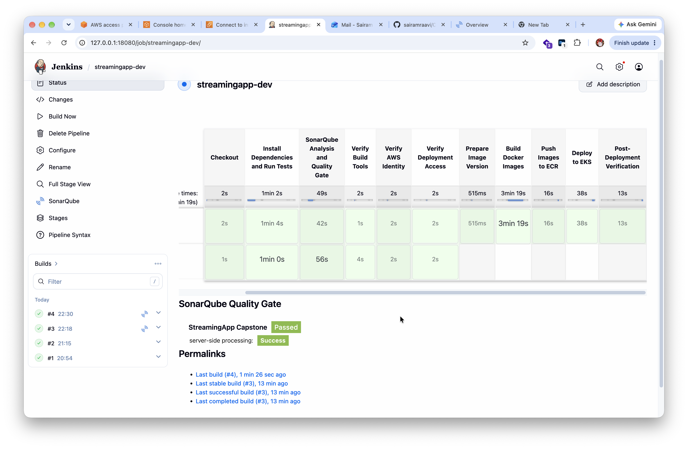
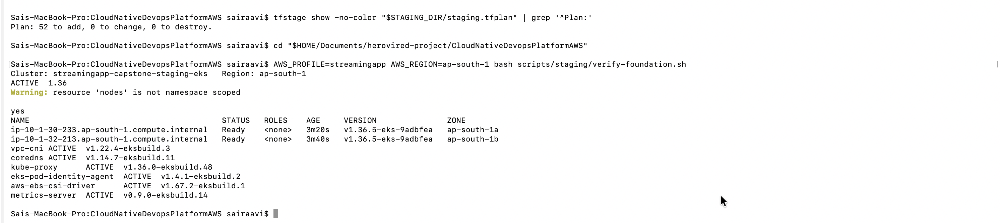

# Follow one release from GitHub to staging

A release is a set of five images built from one Git commit. The Jenkins build number distinguishes two builds of the same commit. A tag helps you find an image; its digest identifies the exact image contents.

## 1. Prepare Jenkins once

Follow [chapter 5](05-jenkins-and-logs.md) to install Jenkins, connect SonarQube and create the `streamingapp-dev` job. Choose **Pipeline script from SCM**, select the branch you actually push to and enter `Jenkinsfile` as the script path. Jenkins needs an existing dev Helm release to upgrade. Create that first in [chapter 3](03-cluster-and-application.md).

## 2. Push a change and watch the build

Open the job and select the new build. Its cause should identify a GitHub push. In **Console Output**, follow the work in order:

1. Check out the commit and run the backend and frontend tests.
2. Submit the code to SonarQube and read the quality gate result.
3. Check the build tools, AWS role and permission to update dev.
4. Build five Linux amd64 images. Push each image to ECR with the commit and build number in its tag.
5. Update dev using Helm. Wait for each deployment, check its image and request the public website.



The stage names and defaults in your current build come from the [root Jenkinsfile](../Jenkinsfile). The screenshot records an earlier run.

## 3. Prepare staging before the first promotion

Staging has its own cluster, namespace, hostname, certificate, database credentials and media bucket. Create these with the [combined setup](setup-dev-stage-prod.md). If you already created the staging Terraform resources by hand, use the workstation scripts below from the repository root with that account's staging backend and private inputs configured. The preparation script reads the saved staging workloads plan, checks the allowed changes and applies them automatically. That historical script assumes the original staging hostname. For another domain, use the combined runner and its private configuration.

```bash
bash scripts/staging/verify-foundation.sh
bash scripts/staging/sync-application-secret.sh
bash scripts/staging/prepare-promotion.sh
```

Look for ready nodes in two zones, an issued certificate and Ready conditions for both secret resources. The preparation script gives Jenkins the deployment access and Helm settings it will use.



## 4. Check what was promoted

Use the same Jenkins job. With **DEPLOY_TO_DEV** selected, the job deploys to dev and automatically enters **Promote to Staging** after dev passes. Clearing the box skips deployment. The [promotion script](../scripts/staging/promote.sh) resolves each ECR image to its digest, installs or upgrades the staging release, and checks all five deployments.

Using your staging kubeconfig, run:

```bash
kubectl --context streamingapp-capstone-staging -n streaming-app-stg get deployments -o 'custom-columns=SERVICE:.metadata.name,READY:.status.readyReplicas,IMAGE:.spec.template.spec.containers[0].image'
```

Look for ready replicas in **every** row and the five expected image digests. Then use the staging website to log in, upload a test video, play it and chat from two browsers. During the recorded attempt the frontend started, but four backends failed to log in to Atlas. A synchronized Kubernetes secret only tells you that the secret was copied. Confirm the database user, password encoding, database permissions and current NAT access entries before rerunning.

## 5. Decide when to release production

Record the staging-tested digests, test results and deployed-image scan findings. Have the release owner review those results, confirm a rollback release and test a database restore before sending users to production. See the [production planning scripts](../scripts/prod/README.md) and [operator-run setup](setup-dev-stage-prod.md). The root Jenkins job ends at staging. A completed production approval, rollout and rollback still need a live demonstration.
