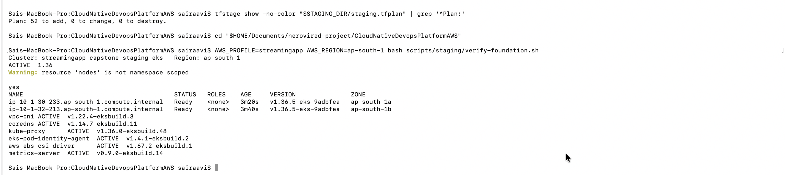

# Submission evidence and completion checklist

Evidence spans multiple dev sessions and two AWS accounts. Use the recorded environment and milestone when captioning an image. Selective links below supplement images embedded in the guides. The [full historical inventory](screenshots/) and [later evidence directory](evidence/) contain additional captures. Account identifiers, IPs, user names and email/browser context may appear in original screenshots. Review before redistribution.

## Local acceptance and containers

- [Containers running](screenshots/local-validation/01-containers-running.png)
- [Refresh success after](screenshots/local-validation/04-refresh-success-after.png)
- [Backend health checks](screenshots/local-validation/05-backend-health-checks.png)
- [Remote state verified](screenshots/local-validation/12-remote-state-verified.png)
- [Vpc resource map](screenshots/local-validation/15-vpc-resource-map.png)
- [Amd64 application images](screenshots/local-validation/26-amd64-application-images.png)
- [Ecr published images](screenshots/local-validation/27-ecr-published-images.png)
- [Frontend scan after runtime upgrade](screenshots/local-validation/30-frontend-scan-after-runtime-upgrade.png)

## AWS, EKS and authorization

- [Eks apply complete](screenshots/eks/05-eks-apply-complete.png)
- [Nodes ready two azs](screenshots/eks/06-nodes-ready-two-azs.png)
- [External secrets operator ready](screenshots/eks/14-external-secrets-operator-ready.png)
- [Aws load balancer controller ready](screenshots/eks/16-aws-load-balancer-controller-ready.png)
- [Application deployments and ingress](screenshots/eks/17-application-deployments-and-ingress.png)
- [Public dns and https validation](screenshots/eks/18-public-dns-and-https-validation.png)
- [Admin api normal user forbidden](screenshots/eks/23b-admin-api-normal-user-forbidden.png)
- [Jenkins infrastructure ready](screenshots/eks/39-jenkins-infrastructure-ready.png)
- [Jenkins eks scoped access](screenshots/eks/45-jenkins-eks-scoped-access.png)

## Dev application and operations

- [Admin video upload success](screenshots/eks/20-admin-video-upload-success.png)
- [Video playback success](screenshots/eks/21-video-playback-success.png)
- [Frontend hpa scale up](screenshots/eks/26-frontend-hpa-scale-up.png)
- [Frontend hpa scale down](screenshots/eks/27-frontend-hpa-scale-down.png)
- [Monitoring persistent volumes bound](screenshots/eks/31-monitoring-persistent-volumes-bound.png)
- [Prometheus target health](screenshots/eks/34b-prometheus-target-health.png)
- [Alertmanager test alert](screenshots/eks/36-alertmanager-test-alert.png)
- [Jenkins sonarqube quality gate](screenshots/eks/56-jenkins-sonarqube-quality-gate.png)
- [Jenkins build push deploy success](screenshots/eks/57-jenkins-build-push-deploy-success.png)
- [Jenkins github triggered build](screenshots/eks/61-jenkins-github-triggered-build.png)
- [Grafana jenkins monitoring](screenshots/eks/65-grafana-jenkins-monitoring.png)
- [Deployed release ecr scan results](screenshots/eks/66-deployed-release-ecr-scan-results.png)
- [Alb access logs delivered](screenshots/eks/69-alb-access-logs-delivered.png)
- [Dev environment teardown](screenshots/eks/70-dev-environment-teardown.png)
- [Jenkins job restored](screenshots/eks/74-jenkins-job-restored.png)
- [Restored jenkins pipeline deployment](screenshots/eks/76-restored-jenkins-pipeline-deployment.png)

## TLS and private storage

- [Acm certificate issued](screenshots/security/04-acm-certificate-issued.png)
- [Alb https listener](screenshots/security/06-alb-https-listener.png)

## Media persistence

- [Media bucket security](screenshots/storage/03-media-bucket-security.png)
- [Uploaded media objects](screenshots/storage/06-uploaded-media-objects.png)

## Staging and final acceptance

| Area | Recorded status | Next acceptance evidence |
| --- | --- | --- |
| Dev application, delivery and operations | Implemented and verified across historical sessions | Retain existing captures. |
| Staging EKS, TLS and secret sync | Implemented and verified | Foundation shown above. Certificate issued and both secret resources Ready in the operator transcript. |
| Automatic staging promotion | Partially implemented end to end | After successful promotion, capture five verified digests and Finished: SUCCESS in Docs/evidence/staging-02-release-promotion.png. |
| Staging user journey and rollback | Planned or pending verification | Capture staging hostname and playback in staging-03-https-playback.png; release history and restored readiness in staging-04-rollback-verified.png. |
| Full scripted dev recovery | Implemented but not fully verified | Capture verified checkpoint, successful up and restored services from the same drill. |
| Image remediation and database recovery | Partially implemented / pending | Attach current deployed digest scan counts and an isolated Atlas restore with record-level readback. |
| Production | Planned or pending | No verified production apply, secure approval, rollout, rollback or recovery evidence. |

The current submission establishes functional dev delivery and an attempted staging promotion. The last recorded staging check had frontend 1/1 and four backends 0/1; Atlas rejected the database login. No new runtime validation was performed for this submission.
