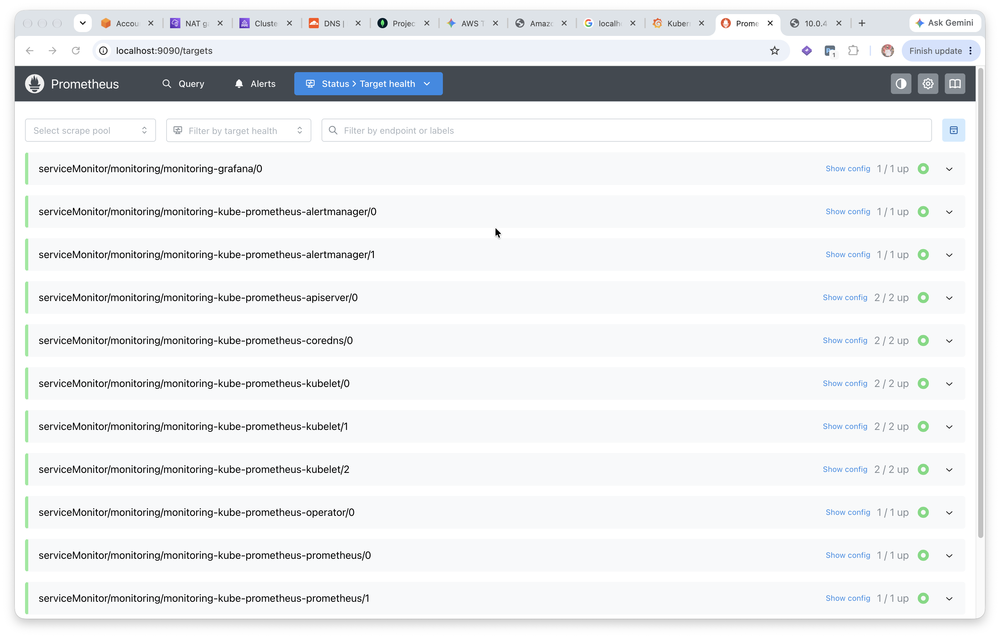
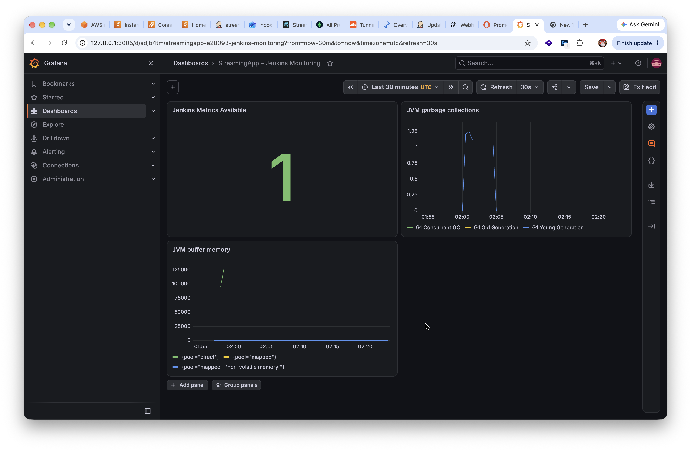

# Operating and verifying the deployed platform

## Application and data path — implemented and verified in dev

The [application chart](../helm/streamingapp/) installs five Deployments, ClusterIP Services, service accounts and HTTP readiness/liveness probes. Kubernetes Ingress maps /api/admin, /api/chat, /socket.io, /api/streaming, /api and / to their respective Services. ALB targets pod IPs; ACM terminates HTTPS. Nodes reach Atlas through NAT. S3 stores the media while Atlas stores user, catalogue and chat records. The chart's in-cluster MongoDB is disabled for the cloud deployment.

On the **Mac, repository root**, set CAPSTONE_CTX, CAPSTONE_NS and APP_DOMAIN for the same environment. **Read-only** acceptance checks. Expect five available deployments, the current Ingress and an HTTP 200 JSON response:

```bash
kubectl --context "$CAPSTONE_CTX" -n "$CAPSTONE_NS" get deployments,svc,ingress,hpa
kubectl --context "$CAPSTONE_CTX" -n "$CAPSTONE_NS" rollout status deployment/frontend
curl -fsS -o /dev/null -w '%{http_code} %{content_type}\n' "https://$APP_DOMAIN/api/streaming/videos/featured"
```

Historical dev acceptance included registration/login, admin upload, playback, chat between two users, persistence after refresh, and denial of privileged requests without the proper role. In the EKS environment Metrics Server supplies CPU utilization to four HPAs; the observed dev range was 1–3 pods at a 70% CPU target. Cluster Autoscaler handles worker capacity separately. Node-group discovery alone does not demonstrate an increase in worker count.

## Observability — implemented and verified in dev

| Question | Flow and verification |
| --- | --- |
| Is a target being scraped? | Node exporter, kubelet and kube-state-metrics feed Prometheus. Check target health and `up` in the UI. For Jenkins, query `up{job="jenkins"}` and inspect JVM counters. Refresh the EC2 private-IP scrape target after recreation. |
| Can operators see load and alert delivery? | Grafana queries Prometheus; three encrypted gp3 claims supported Grafana, Prometheus and Alertmanager. The synthetic PrometheusRule fires after its expression stays true for one minute. Alertmanager selected the Outlook receiver; SES delivered firing and resolved mail. |
| Did a real request reach CloudWatch? | Mark an HTTPS request with a unique query value. Fluent Bit delivers the matching frontend stdout event and pod metadata to the application log group. Jenkins uses a different path: its systemd journal → CloudWatch Agent → instance-specific stream. |
| Did the ALB deliver access logs? | Inspect enabled, bucket and prefix attributes; generate real traffic and check for dated .log.gz objects under the current account, region and ALB ID. Two objects were observed. The AWS test object alone only verifies the permission test. |





Configuration and install commands are in [setup steps 15–18 and 24–26](setup-process.md). Sources: [stack values](../Monitoring/kube-prometheus-stack-values.yaml), [alert receiver](../Monitoring/alertmanager-email.yaml), [Grafana dashboard](../Monitoring/dashboards/jenkins-monitoring.json), [Fluent Bit](../Monitoring/cloudwatch/fluent-bit-values.yaml) and [EC2 journal agent](../Monitoring/cloudwatch/jenkins-agent.json).

## Incident record and lessons

| Symptom | Diagnostic and established cause | Resolution and verification |
| --- | --- | --- |
| STS ExpiredToken; Terraform state lock | Check STS with the intended profile and shell jobs. A suspended plan retained the lock. | Renew the matching login; resume/cancel the owning process cleanly. Verify the reviewed plan. |
| SSH or Ansible unreachable | Compare Terraform's current public IP and administrator /32; distinguish timeout from a host-key failure. | Refresh inventory and verify the new host fingerprint. Subsequent Ansible recap showed zero failures. |
| Browser catalogue returned 404 | Direct HTTPS catalogue returned 200. Browser used /api/streaming/streaming/videos/featured. | Build with API base /api because the client appends /streaming. Playback subsequently succeeded in dev. |
| Cloudflare 1033 or 502 | Inspect connector and token file for 1033; probe the origin and nginx separately for 502. | Restore valid connector configuration. After SonarQube restart, wait for /api/system/status to report UP; HTTP 200 with STARTING is insufficient. |
| ECR ScanNotFoundException | Inspect the OCI index returned by batch-get-image. The tag referenced a platform index. | Query describe-image-scan-findings for the amd64 child digest. Historical scans then reported COMPLETE. |
| No firing email | Query ALERTS and Alertmanager receivers. The inactive test expression returned no series. | Temporarily enable the live rule, wait for email, then restore the inactive expression and verify resolution. |
| Backup checksum step returned no results | Check for a nonempty SHA256SUMS inside the actual backup directory. An incomplete backup contained only two files. | Finish backup and verify the manifest on both hosts; all four archive checks passed. Explicit Compose project/file paths restored SonarQube after restart failed in a different working directory. |
| Jenkins forbidden on ExternalSecret | AWS authenticated the Jenkins role. Kubernetes denied get on the custom resource. | Bootstrap validates ExternalSecret as operator; promotion checks the application Secret. Build 17 passed this point. |
| Staging backend CrashLoopBackOff | Inspect health and sanitized error classification. A literal at-sign in the credential broke SRV parsing. After encoding it, the driver reached Atlas and reported authentication failed. | Secret synchronized and pods restarted. The final login failure remains open; verify the user/password in the correct Atlas project and confirm all rollouts before claiming success. |

**Security finding:** the four backend connection modules in this checkout log their complete MongoDB URI on startup. Limit access to existing logs, rotate affected credentials and remove URI logging before capturing or publishing logs. Screenshot review cannot establish what was previously exported to CloudWatch.
