# StreamingApp: how we built it and how to run it again

The first thing to try as a viewer is signing in and playing a video. Behind that simple action are five services. The frontend draws the page. Auth checks the login. Admin handles the upload. Streaming finds the video. Chat carries messages between viewers. We first ran those services on a laptop, then moved them to AWS, and finally taught Jenkins to release changes for us.

**How to use this page:** Read the numbered stages in order for the project story. To build it yourself, expand **Show the setup steps** under each stage. Run one block at a time and check its result before continuing. Commands start on the Mac in Bash, at the repository root unless the step says otherwise. Keep the same terminal open for values such as the domain and image tag. The screenshots show earlier runs; use your own account, addresses and passwords.

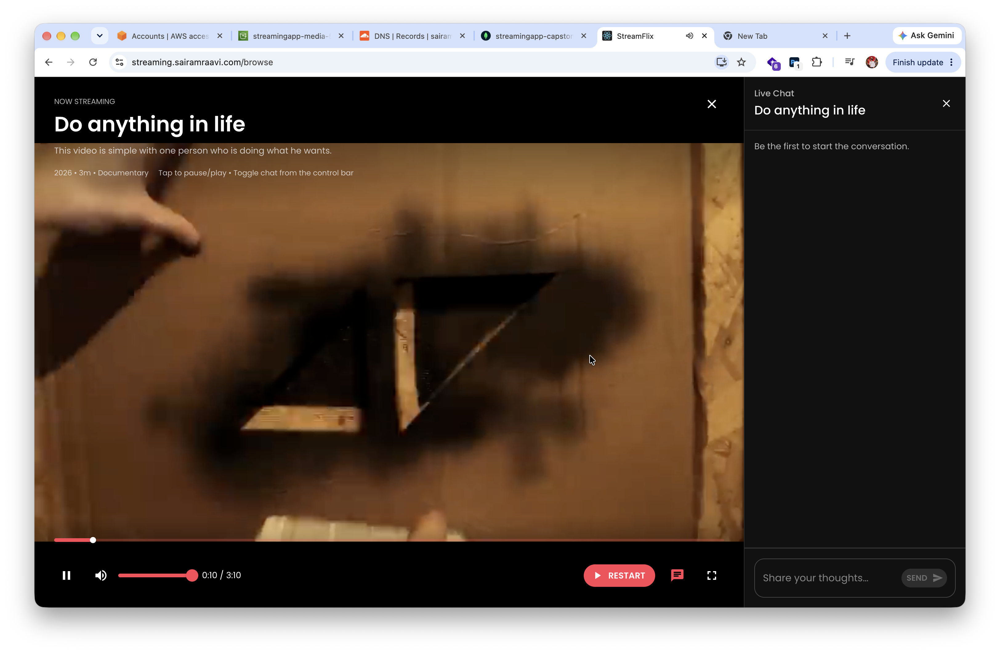

**Already have a working backup and want to rebuild?** Jump to [Repeat the setup automatically](#repeat-the-setup-automatically). On your first installation, you will create the private inputs as you go.


## 1. Run the app with Docker

We started here so we could tell an application bug from an AWS problem. Docker packages each service with the software it needs. Compose starts all five, plus MongoDB, with one command. Open localhost:3000, register a test user, sign in and refresh the page. During the first test a refresh returned 404. Configuring nginx to serve the React entry page for browser routes fixed it.

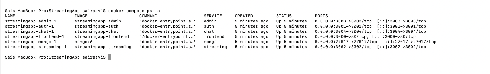

Compose lists the containers together. The frontend publishes the port you open in your browser.

<details>
<summary>Show the setup steps for stage 1</summary>

### 1. Get the repository and confirm tools

**Mac:** clone only if you do not already have a checkout.

Checkout the implementation branch.

```bash
git clone https://github.com/sairamraavi/CloudNativeDevopsPlatformAWS.git
cd CloudNativeDevopsPlatformAWS
git switch feature/capstone-end-to-end
git status --short
```

Existing contributors can continue on their working branch; Jenkins must use the branch containing the committed changes.

Inspect tool versions.

```bash
git --version
docker version
docker compose version
terraform version
kubectl version --client
helm version --short
ansible --version
python3 --version
aws --version
```

Start Docker Desktop if the Docker server is unavailable. Install missing tools before proceeding. The Jenkinsfile uses Helm 4's `--rollback-on-failure` option.

**Expected:** all tools respond and you know which branch you are using.

### 2. Start an AWS session and choose your domain

Create an SSO profile if needed using `aws configure sso`; use your organization's supplied start URL and permission set. Then set your own values:

Authenticate and verify caller.

```bash
export AWS_PROFILE=streamingapp
export AWS_REGION=ap-south-1
export AWS_DEFAULT_REGION="$AWS_REGION"
export AWS_PAGER=''
export APP_DOMAIN=streaming.example.com
# Use aws login --profile "$AWS_PROFILE" instead for the personal login-based profile.
aws sso login --profile "$AWS_PROFILE"
aws sts get-caller-identity --query '{Account:Account,Arn:Arn}' --output json
```

Replace `streaming.example.com` with a subdomain you control. After confirming the displayed account is the intended account:

Bind the intended account and domain.

```bash
export CAPSTONE_ACCOUNT_ID="$(aws sts get-caller-identity --query Account --output text)"
export TF_VAR_expected_account_id="$CAPSTONE_ACCOUNT_ID"
export TF_VAR_aws_region="$AWS_REGION"
export TF_VAR_application_domain="$APP_DOMAIN"
export TF_VAR_media_allowed_origins="$(printf '["https://%s","http://localhost:3000"]' "$APP_DOMAIN")"
```

These exports apply only to this terminal. Repeat them in a new terminal. `ExpiredToken` means you need to log in again. Do not use Ctrl+Z to cancel Terraform: it suspends the process and can leave a state lock held. Use Ctrl+C and let Terraform exit.

### 3. Validate the application locally

Compose reads [docker-compose.yml](../StreamingApp/docker-compose.yml). Each backend Dockerfile installs its Node dependencies and starts one API. The frontend Dockerfile builds the React app and copies its static files into nginx. Compose publishes nginx on port 3000 so you can open the app from your browser.


**Mac, repository root:** copy the example only if `.env` does not exist.

Initialize private local settings.

```bash
test -f StreamingApp/.env || cp StreamingApp/.env.example StreamingApp/.env
git check-ignore StreamingApp/.env
openssl rand -hex 32 | tr -d '\n' | pbcopy
```

Paste the generated value into `JWT_SECRET` privately. Keep the local frontend URLs on ports 3000–3004 as shown in `.env.example`. Compose supplies the local MongoDB connection. AWS placeholder credentials are not usable credentials; local login can be verified first, and cloud media access is configured through workload IAM roles later.

Build Compose and verify service health.

```bash
docker compose -f StreamingApp/docker-compose.yml config --quiet
docker compose -f StreamingApp/docker-compose.yml up -d --build
docker compose -f StreamingApp/docker-compose.yml ps -a
curl -i --max-time 10 http://localhost:3001/health
curl -i --max-time 10 http://localhost:3002/api/health
curl -i --max-time 10 http://localhost:3003/api/health
curl -i --max-time 10 http://localhost:3004/api/health
docker compose -f StreamingApp/docker-compose.yml exec mongo mongosh --quiet --eval 'db.adminCommand({ ping: 1 })'
```

Open `http://localhost:3000`, register, log in and reload a nested route. Expected: health responses succeed, MongoDB returns `{ ok: 1 }`, and refresh does not return 404. In an early test, signing in worked but refreshing a nested page returned 404. The [frontend nginx configuration](../StreamingApp/frontend/nginx.conf) serves the React entry page for client-side routes. [Before the fix](screenshots/local-validation/03-refresh-404-before.png) · [After the fix](screenshots/local-validation/04-refresh-success-after.png)


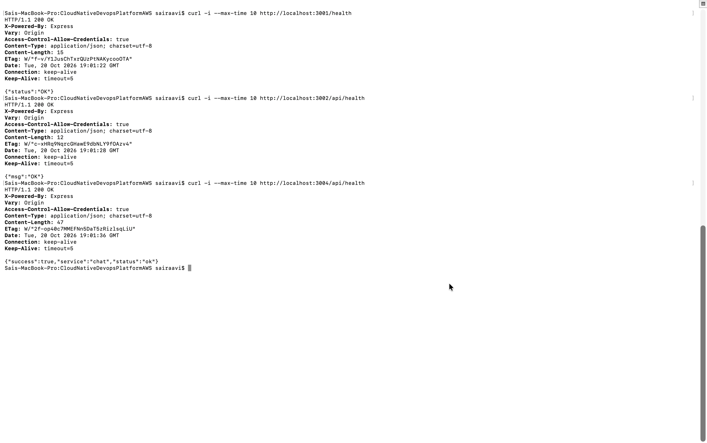

</details>

## 2. Create the AWS resources and publish the images

The app needs a place for its images, videos and credentials. Terraform first creates an S3 bucket to remember which resources it manages. A second Terraform directory creates the resources we keep between sessions. ECR stores the five images. S3 stores uploaded media. Secrets Manager holds the database address and signing secret. We also validated the HTTPS certificate in Cloudflare. When we moved from the lab to the personal account, we repeated this stage with a new state bucket and registry.

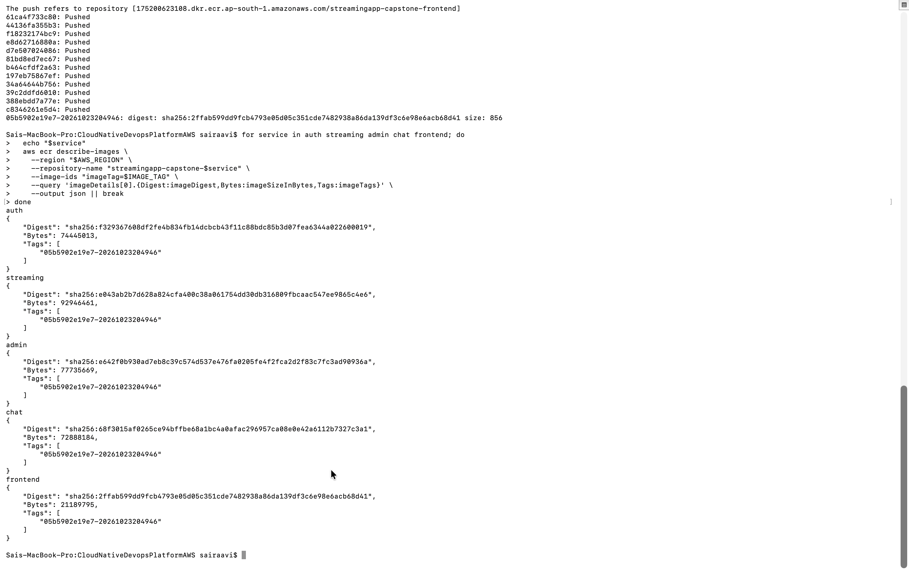

After building for Linux amd64, we could find each service image in the account’s registry.

<details>
<summary>Show the setup steps for stage 2</summary>

### 4. Create or reconnect Terraform remote state

Think of state as Terraform’s inventory. `init` connects this directory to its backend and installs providers. `plan` shows the proposed changes. `apply` executes a saved plan. Use a fresh checkout for a new account so an old .terraform directory or local state cannot point this run at the lab environment.

The original dev lifecycle uses three independent Terraform roots. Staging adds Terraform/staging-data and Terraform/environments/staging.

| Root | Purpose | Keep between development sessions? |
| --- | --- | --- |
| `Terraform/bootstrap` | State bucket and protection | Yes |
| `Terraform/persistent` | ECR, media, secret metadata, certificate, ALB log bucket | Yes |
| `Terraform/environments/dev` | EKS, networking, IAM, Jenkins and development infrastructure | Can be destroyed and recreated |

**Existing account with a configured backend:** set CAPSTONE_STATE_BUCKET to its bucket name first. Then run the following and keep the existing state bucket. Do not create a replacement or migrate to an empty backend.

Read the existing bootstrap plan.

```bash
terraform -chdir=Terraform/bootstrap init -reconfigure \
  -backend-config="bucket=${CAPSTONE_STATE_BUCKET:?Set the existing state bucket for this account}" \
  -backend-config="key=bootstrap/terraform.tfstate" -backend-config="region=$AWS_REGION" \
  -backend-config=encrypt=true -backend-config=use_lockfile=true
terraform -chdir=Terraform/bootstrap plan -input=false
```

**First deployment in a new account only:** the state bucket must exist before using the S3 backend. Temporarily disable the backend declaration, create the bucket using local state, then migrate that state:

Create and migrate initial state.

```bash
mv Terraform/bootstrap/backend.tf Terraform/bootstrap/backend.tf.disabled
terraform -chdir=Terraform/bootstrap init
terraform -chdir=Terraform/bootstrap validate
terraform -chdir=Terraform/bootstrap plan -input=false -out=bootstrap.tfplan
terraform -chdir=Terraform/bootstrap apply bootstrap.tfplan
export CAPSTONE_STATE_BUCKET="$(terraform -chdir=Terraform/bootstrap output -raw terraform_state_bucket_name)"
mv Terraform/bootstrap/backend.tf.disabled Terraform/bootstrap/backend.tf
terraform -chdir=Terraform/bootstrap init -migrate-state \
  -backend-config="bucket=$CAPSTONE_STATE_BUCKET" \
  -backend-config="key=bootstrap/terraform.tfstate" \
  -backend-config="region=$AWS_REGION" \
  -backend-config="encrypt=true" \
  -backend-config="use_lockfile=true"
```

Answer `yes` to copy the existing local state. Keep any local state backups private. Never commit state or saved plans.

**Both paths:**

Verify the retained state.

```bash
export CAPSTONE_STATE_BUCKET="$(terraform -chdir=Terraform/bootstrap output -raw terraform_state_bucket_name)"
terraform -chdir=Terraform/bootstrap state list
terraform -chdir=Terraform/bootstrap plan -input=false
```

Expected: protected state-bucket resources exist and the follow-up plan reports no changes. Save one screenshot of remote-state verification.

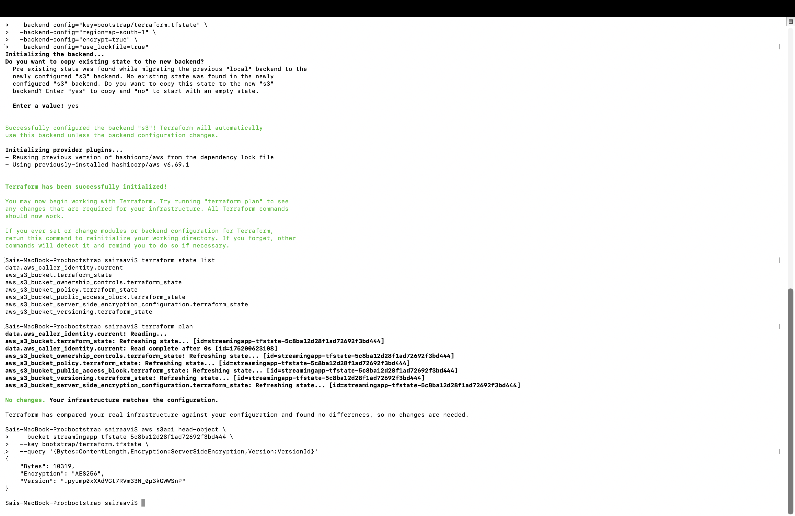

### 5. Provision persistent resources

Plan persistent resources.

```bash
terraform -chdir=Terraform/persistent init \
  -backend-config="bucket=$CAPSTONE_STATE_BUCKET" \
  -backend-config="key=persistent/terraform.tfstate" \
  -backend-config="region=$AWS_REGION" \
  -backend-config="encrypt=true" \
  -backend-config="use_lockfile=true"
terraform -chdir=Terraform/persistent validate
terraform -chdir=Terraform/persistent plan -input=false -out=persistent.tfplan
```

Review the plan, especially account, region, domain and CORS origins. Apply only the intended resources:

Provision persistent resources.

```bash
terraform -chdir=Terraform/persistent apply persistent.tfplan
terraform -chdir=Terraform/persistent output
export CAPSTONE_MEDIA_BUCKET="$(terraform -chdir=Terraform/persistent output -raw media_bucket_name)"
export TF_VAR_media_bucket_arn="$(terraform -chdir=Terraform/persistent output -raw media_bucket_arn)"
export TF_VAR_application_secret_arn="$(terraform -chdir=Terraform/persistent output -raw application_dev_secret_arn)"
export CAPSTONE_CERT_ARN="$(terraform -chdir=Terraform/persistent output -raw application_certificate_arn)"
export CAPSTONE_ALB_LOG_BUCKET="$(terraform -chdir=Terraform/persistent output -raw alb_logs_bucket_name)"
```

Expected: five ECR repositories, private media bucket, secret container, ACM certificate request and ALB access-log bucket. The secret container does **not** yet contain application credentials.

### 6. Validate the HTTPS certificate in Cloudflare

Obtain the DNS validation record.

```bash
terraform -chdir=Terraform/persistent output application_certificate_dns_records
```

In Cloudflare DNS, add each returned CNAME exactly as provided. Set validation records to **DNS only**. Leave these records in place for certificate renewal.

Check certificate issuance.

```bash
aws acm describe-certificate --region "$AWS_REGION" \
  --certificate-arn "$CAPSTONE_CERT_ARN" \
  --query 'Certificate.{Domain:DomainName,Status:Status}' --output json
```

Continue when status is `ISSUED`. Keep the validation record for renewal. You will add a separate application record after the load balancer exists.

### 7. Create Atlas and populate application secrets

1. Create an Atlas project and cluster in the intended region. The original development setup used the free tier, which had no managed backups enabled; this is a development compromise.
2. Create a database user with `readWrite` access to the `streamingapp` database. Store its password privately.
3. Add your current Mac public IPv4 as a `/32` Atlas IP access entry for testing. Do not open access to all addresses.
4. Copy your cluster's SRV hostname from Atlas Connect. Use the password prompt, not a password in shell history:

Test Atlas access.

```bash
export ATLAS_HOST='replace-with-your-cluster.mongodb.net'
docker run --rm -it mongo:8.0 mongosh \
  "mongodb+srv://${ATLAS_HOST}/streamingapp?retryWrites=true&w=majority&authSource=admin" \
  --username streamingapp-dev --password
```

Inside mongosh:

```javascript
db.runCommand({ ping: 1 })
db.getName()
const verificationId = new ObjectId();
db.capstone_connection_checks.insertOne({ _id: verificationId, purpose: 'connectivity-check', checkedAt: new Date() });
db.capstone_connection_checks.findOne({ _id: verificationId });
db.capstone_connection_checks.deleteOne({ _id: verificationId });
exit
```

In AWS Secrets Manager, open `streamingapp-capstone/dev/application` and store two key/value pairs: `MONGO_URI` (complete Atlas URI with URL-encoded credentials and database name) and `JWT_SECRET` (generated random secret). Generate the JWT secret using the clipboard command in step 3. It is a signing secret, not a login token.

Verify a current secret version.

```bash
aws secretsmanager list-secret-version-ids \
  --secret-id "$TF_VAR_application_secret_arn" \
  --query 'Versions[].{Version:VersionId,Stages:VersionStages}' --output table
```

Expected: a version marked `AWSCURRENT`. Screenshot version metadata only. Do not print secret contents.

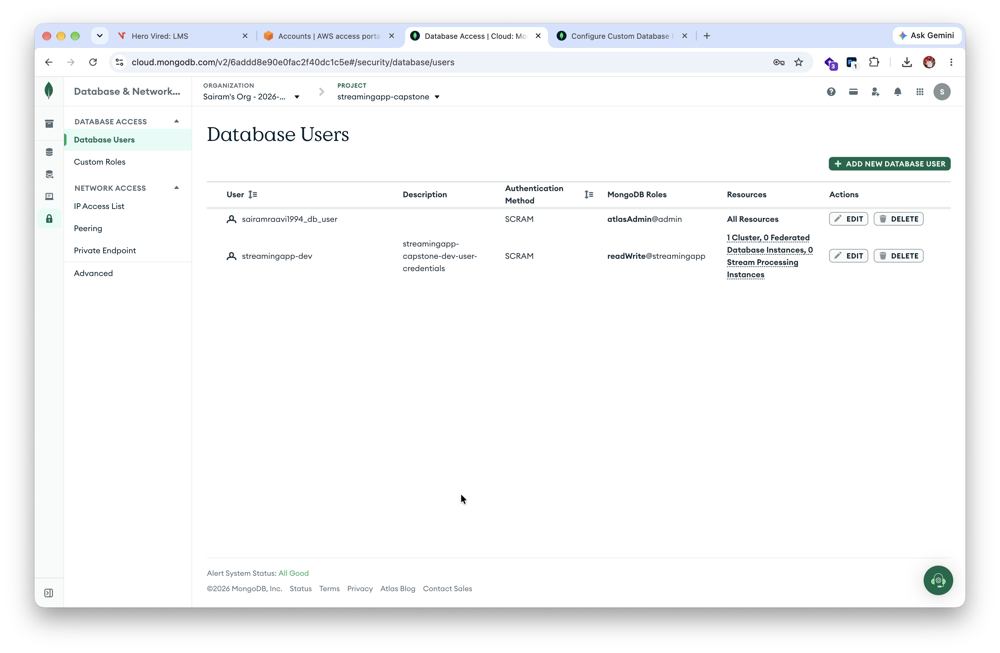

### 8. Build and publish the first cloud images

The first deployment needs images before Jenkins exists. Use the correct Docker build contexts below. Cloud frontend API URLs are build-time settings; changing a Kubernetes environment variable does not rebuild JavaScript.

Publish five release images.

```bash
export ECR_REGISTRY="${CAPSTONE_ACCOUNT_ID}.dkr.ecr.${AWS_REGION}.amazonaws.com"
export IMAGE_TAG="$(git rev-parse --short=12 HEAD)-$(date -u +%Y%m%d%H%M%S)"
aws ecr get-login-password --region "$AWS_REGION" |
  docker login --username AWS --password-stdin "$ECR_REGISTRY"
docker build --pull --platform linux/amd64 \
  -t "$ECR_REGISTRY/streamingapp-capstone-auth:$IMAGE_TAG" \
  StreamingApp/backend/authService
for service in streaming admin chat; do
  docker build --pull --platform linux/amd64 \
    -f "StreamingApp/backend/${service}Service/Dockerfile" \
    -t "$ECR_REGISTRY/streamingapp-capstone-$service:$IMAGE_TAG" \
    StreamingApp/backend || break
done
docker build --pull --platform linux/amd64 \
  --build-arg REACT_APP_AUTH_API_URL=/api \
  --build-arg REACT_APP_STREAMING_API_URL=/api \
  --build-arg REACT_APP_ADMIN_API_URL=/api/admin \
  --build-arg REACT_APP_CHAT_API_URL=/api/chat \
  -t "$ECR_REGISTRY/streamingapp-capstone-frontend:$IMAGE_TAG" StreamingApp/frontend
docker run --rm --platform linux/amd64 \
  "$ECR_REGISTRY/streamingapp-capstone-frontend:$IMAGE_TAG" nginx -t
for service in auth streaming admin chat frontend; do
  docker push "$ECR_REGISTRY/streamingapp-capstone-$service:$IMAGE_TAG" || break
done
```

Stop if any build/push fails. Record the image tag. **Do not use `/api/streaming` for `REACT_APP_STREAMING_API_URL`**: the client already appends `/streaming`, causing duplicate paths and 404 responses.

Inspect each image and query scans using the `linux/amd64` child digest when its tag points to an OCI image index:

Inspect image platforms.

```bash
docker buildx imagetools inspect "$ECR_REGISTRY/streamingapp-capstone-frontend:$IMAGE_TAG"
```

Copy the actual amd64 digest into the next command, replacing the placeholder:

Read scan findings.

```bash
aws ecr describe-image-scan-findings \
  --repository-name streamingapp-capstone-frontend \
  --image-id imageDigest=REPLACE_WITH_ACTUAL_SHA256_DIGEST \
  --query '{Status:imageScanStatus.status,Counts:imageScanFindings.findingSeverityCounts}'
```

Repeat for all five services. A completed scan with empty counts means no findings reported by that scan, not proof of complete security. The historical frontend release had unresolved findings; do not label it production-approved. Capture the scan summary and any remediation evidence.

</details>

## 3. Bring the site online

With images available, Terraform created the network, private workers in two zones, EKS and a separate machine for Jenkins. We allowed the two NAT addresses in Atlas so the pods could reach the database. Helm installed the application from the repository’s chart. Once the load balancer had a hostname, we pointed the application DNS record at it. To check the result, we signed in, uploaded a small video, played it and sent a message from a second browser.

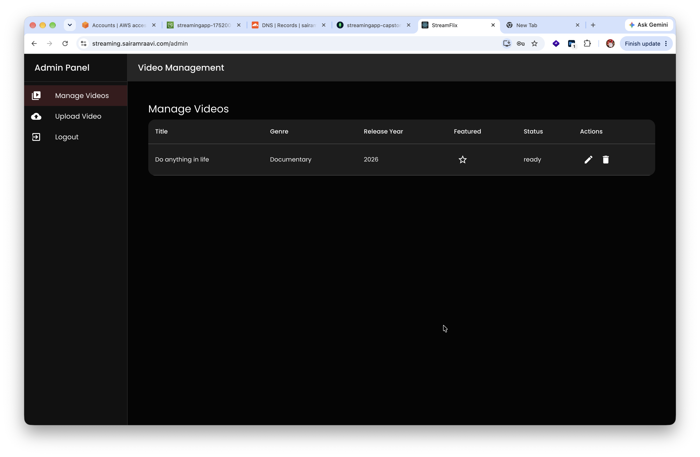

An upload through the public site exercised the browser, admin API and media storage together.

<details>
<summary>Show the setup steps for stage 3</summary>

### 9. Supply development infrastructure inputs

Create the Jenkins SSH key only if it is absent. Never overwrite an existing key needed for recovery.

Prepare SSH identity and network inputs.

```bash
test -s "$HOME/.ssh/streamingapp-capstone-jenkins" || \
  ssh-keygen -t ed25519 -f "$HOME/.ssh/streamingapp-capstone-jenkins" -C streamingapp-capstone-jenkins
export CAPSTONE_ADMIN_IP="$(curl -4 --fail --silent --show-error https://checkip.amazonaws.com)"
export TF_VAR_eks_public_access_cidrs="$(printf '["%s/32"]' "$CAPSTONE_ADMIN_IP")"
export TF_VAR_jenkins_admin_cidr="${CAPSTONE_ADMIN_IP}/32"
export TF_VAR_jenkins_public_key_path="$HOME/.ssh/streamingapp-capstone-jenkins.pub"
export TF_VAR_availability_zones='["ap-south-1a","ap-south-1b"]'
export TF_VAR_nat_mode=per_az
```

In IAM, locate the **IAM role ARN** of your SSO administrator role (not the STS assumed-role session ARN). In EC2, select a verified Canonical Ubuntu 24.04 amd64 AMI in your region. Set both values:

Set verified EKS inputs.

```bash
export TF_VAR_eks_admin_role_arn='REPLACE_WITH_YOUR_IAM_ROLE_ARN'
export TF_VAR_jenkins_ami_id='REPLACE_WITH_VERIFIED_REGIONAL_UBUNTU_AMI_ID'
```

These placeholders must be replaced before planning. The checked-in EKS configuration requires `per_az` NAT for its private-node design. Choose different AZs only after updating the configuration consistently.

### 10. Create EKS, networking and Jenkins EC2

During the original build we tested networking separately. We reviewed a VPC without NAT, then compared a single NAT gateway with one gateway per availability zone. The final EKS configuration uses private workers with a gateway in each zone. Those two public NAT addresses are what Atlas sees when the app connects. For a rebuild, the dev Terraform root creates this network for you.

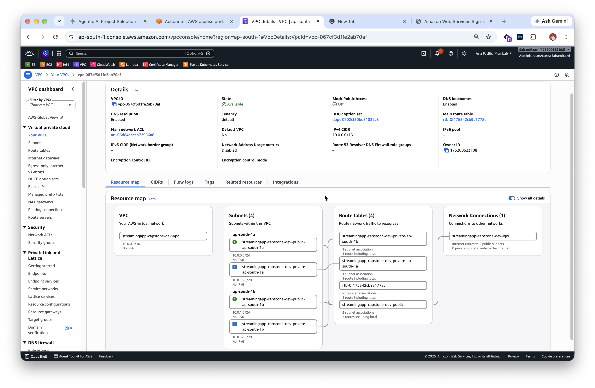

Plan dev infrastructure.

```bash
terraform -chdir=Terraform/environments/dev init \
  -backend-config="bucket=$CAPSTONE_STATE_BUCKET" \
  -backend-config="key=environments/dev/terraform.tfstate" \
  -backend-config="region=$AWS_REGION" \
  -backend-config="encrypt=true" \
  -backend-config="use_lockfile=true"
terraform -chdir=Terraform/environments/dev validate
terraform -chdir=Terraform/environments/dev plan -input=false -out=dev.tfplan
```

Review all changes. On recreation, outputs such as public IPs, NAT IPs, VPC IDs and endpoints will change. Save the reviewed plan screenshot, then:

Provision dev and verify nodes.

```bash
terraform -chdir=Terraform/environments/dev apply dev.tfplan
export CAPSTONE_CLUSTER_NAME="$(terraform -chdir=Terraform/environments/dev output -raw eks_cluster_name)"
export CAPSTONE_VPC_ID="$(terraform -chdir=Terraform/environments/dev output -raw vpc_id)"
export CAPSTONE_JENKINS_IP="$(terraform -chdir=Terraform/environments/dev output -raw jenkins_public_ip)"
aws eks update-kubeconfig --region "$AWS_REGION" --name "$CAPSTONE_CLUSTER_NAME" --alias streamingapp-capstone-dev --role-arn "$TF_VAR_eks_admin_role_arn"
kubectl --context streamingapp-capstone-dev auth can-i list nodes
kubectl --context streamingapp-capstone-dev get nodes -L topology.kubernetes.io/zone
kubectl --context streamingapp-capstone-dev get pods -n kube-system
terraform -chdir=Terraform/environments/dev output nat_public_ips
```

Expected: two Ready nodes across two AZs and healthy system pods. Add **both new NAT IPs as `/32` entries in Atlas**; remove obsolete NAT entries after replacement. Capture cluster readiness and Atlas access-list evidence.

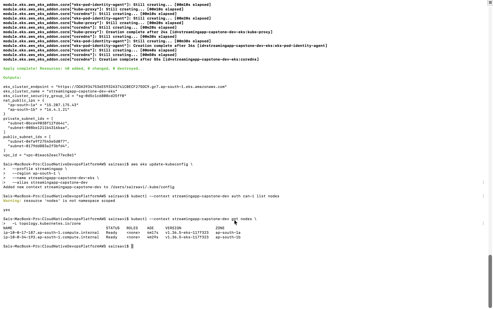

### 11. Install External Secrets and synchronize application credentials

Prepare the application namespace.

```bash
kubectl --context streamingapp-capstone-dev create namespace streaming-app-dev --dry-run=client -o yaml |
  kubectl --context streamingapp-capstone-dev apply -f -
helm repo add external-secrets https://charts.external-secrets.io
helm repo update external-secrets
helm search repo external-secrets/external-secrets --versions | head
```

Select a compatible chart version and replace the placeholder below. The session's repository listing included 2.14.0; verify availability before using it.

Install secrets synchronization.

```bash
export ESO_CHART_VERSION=2.14.0
helm upgrade --install external-secrets external-secrets/external-secrets \
  --version "$ESO_CHART_VERSION" --kube-context streamingapp-capstone-dev \
  -n external-secrets --create-namespace --set installCRDs=true --wait --timeout 5m
export SECRET_READER_ROLE_ARN="$(terraform -chdir=Terraform/environments/dev output -raw secret_reader_role_arn)"
helm upgrade --install application-secrets helm/application-secrets \
  --kube-context streamingapp-capstone-dev -n streaming-app-dev \
  --set-string secretReader.roleArn="$SECRET_READER_ROLE_ARN" \
  --set-string awsRegion="$AWS_REGION"
kubectl --context streamingapp-capstone-dev get secretstore,externalsecret -n streaming-app-dev
kubectl --context streamingapp-capstone-dev wait --for=condition=Ready \
  externalsecret/streamingapp-application -n streaming-app-dev --timeout=180s
```

Continue only after synchronization succeeds. Save readiness evidence without decoding the Kubernetes Secret.

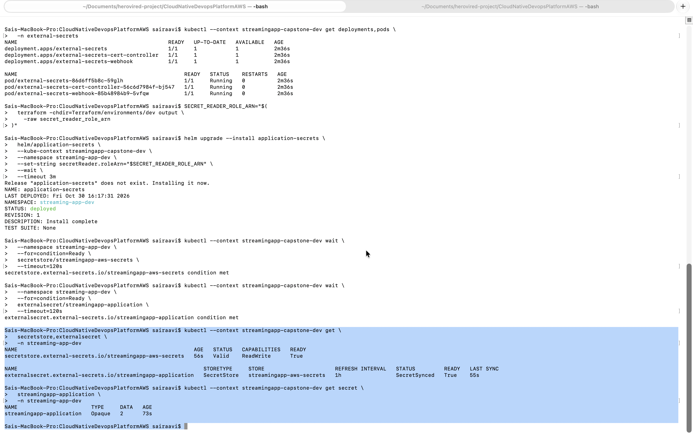

### 12. Install the AWS Load Balancer Controller

Install the ALB controller.

```bash
helm repo add eks https://aws.github.io/eks-charts
helm repo update eks
export CAPSTONE_LBC_ROLE_ARN="$(terraform -chdir=Terraform/environments/dev output -raw load_balancer_controller_role_arn)"
helm upgrade --install aws-load-balancer-controller eks/aws-load-balancer-controller \
  --version 1.14.1 --kube-context streamingapp-capstone-dev -n kube-system \
  --set-string clusterName="$CAPSTONE_CLUSTER_NAME" \
  --set-string region="$AWS_REGION" --set-string vpcId="$CAPSTONE_VPC_ID" \
  --set serviceAccount.create=true --set-string serviceAccount.name=aws-load-balancer-controller \
  --set-string "serviceAccount.annotations.eks\.amazonaws\.com/role-arn=$CAPSTONE_LBC_ROLE_ARN" \
  --set replicaCount=2 --wait --timeout 5m
kubectl --context streamingapp-capstone-dev get deployment aws-load-balancer-controller -n kube-system
kubectl --context streamingapp-capstone-dev get ingressclass alb
```

Expected: controller 2/2 Ready and ingress class `alb`. The chart version matches the checked-in v2.14.1 IAM policy.

### 13. Install the application with this deployment's values

Deploy application with Helm.

```bash
export CAPSTONE_ADMIN_MEDIA_ROLE="$(terraform -chdir=Terraform/environments/dev output -json media_workload_role_arns | python3 -c 'import json,sys; print(json.load(sys.stdin)["admin"])')"
export CAPSTONE_STREAMING_MEDIA_ROLE="$(terraform -chdir=Terraform/environments/dev output -json media_workload_role_arns | python3 -c 'import json,sys; print(json.load(sys.stdin)["streaming"])')"
helm lint helm/streamingapp --set-string image.registry="$ECR_REGISTRY" --set-string image.tag="$IMAGE_TAG" --set-string frontend.tag="$IMAGE_TAG" --set-string app.s3Bucket="$CAPSTONE_MEDIA_BUCKET"
helm upgrade --install streamingapp helm/streamingapp \
  --kube-context streamingapp-capstone-dev -n streaming-app-dev \
  --set-string image.registry="$ECR_REGISTRY" --set-string image.tag="$IMAGE_TAG" \
  --set-string frontend.tag="$IMAGE_TAG" \
  --set-string app.clientUrls="https://$APP_DOMAIN" \
  --set-string app.streamingPublicUrl="https://$APP_DOMAIN" \
  --set-string app.awsRegion="$AWS_REGION" --set-string app.s3Bucket="$CAPSTONE_MEDIA_BUCKET" \
  --set-string services.admin.roleArn="$CAPSTONE_ADMIN_MEDIA_ROLE" \
  --set-string services.streaming.roleArn="$CAPSTONE_STREAMING_MEDIA_ROLE" \
  --set ingress.enabled=true --set-string ingress.host="$APP_DOMAIN" \
  --set-string ingress.certificateArn="$CAPSTONE_CERT_ARN" \
  --wait --timeout 10m
kubectl --context streamingapp-capstone-dev get deployments,pods,ingress -n streaming-app-dev
```

Expected: all five deployments ready and an ALB hostname appears on the ingress. If pods fail, inspect their events/logs before proceeding; common causes are Atlas NAT entries, secret synchronization or incorrect image registry/tag.

### 14. Point DNS at the ALB and test the public application

Inspect ingress hostname.

```bash
kubectl --context streamingapp-capstone-dev get ingress streamingapp -n streaming-app-dev \
  -o jsonpath='{.status.loadBalancer.ingress[0].hostname}{"\n"}'
```

Create your application's Cloudflare CNAME pointing to that hostname, **DNS only** for the initial ACM/ALB validation. Do not replace the certificate validation CNAME.

Verify DNS and HTTPS.

```bash
dig +short CNAME "$APP_DOMAIN"
curl --silent --show-error --max-time 20 -o /dev/null -D - "http://$APP_DOMAIN/"
curl --silent --show-error --max-time 20 -o /dev/null -D - "https://$APP_DOMAIN/"
```

Expected: HTTP redirects to HTTPS; HTTPS returns 200. Register/login, refresh `/browse`, upload and play a small video using an authorized admin, and test chat with two users. Confirm normal users cannot access admin APIs. Do not promote arbitrary users to admin without reviewing the application's authorization implementation.

Capture only major proof: HTTPS, login/API routing, S3 upload, playback, two-user chat and admin rejection. API requests should use your public domain, not localhost.


</details>

## 4. Find out when something goes wrong

A running pod alone cannot tell you whether monitoring works. We applied a small load to the frontend and watched its replica count. Then we installed Prometheus to collect measurements and Grafana to graph them. For the email test, we made one rule deliberately true, waited for Outlook to receive the firing message, then returned the rule to its inactive setting and checked for the resolved email.

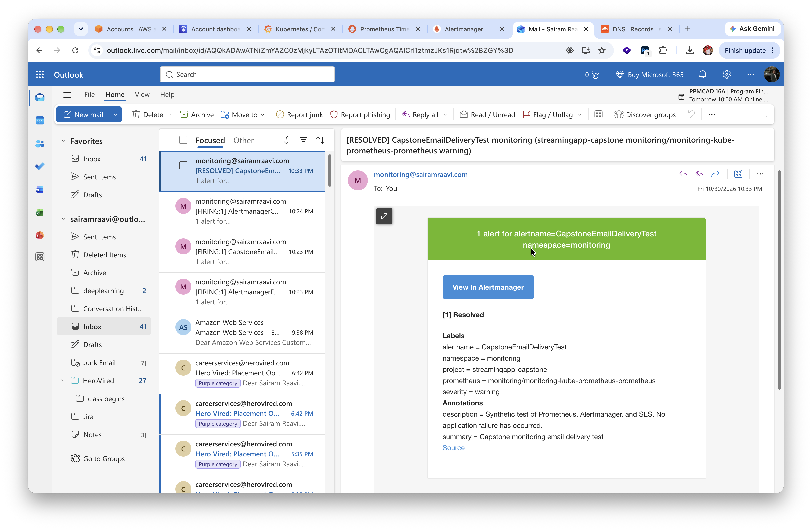

The resolved notification completed the same delivery path as the firing notification.

<details>
<summary>Show the setup steps for stage 4</summary>

### 15. Verify scaling and persistent-storage prerequisites

The current Terraform root includes metrics-server and EBS CSI resources; do not install duplicate copies manually.

Verify metrics and create storage class.

```bash
kubectl --context streamingapp-capstone-dev top nodes
kubectl --context streamingapp-capstone-dev top pods -n streaming-app-dev
kubectl --context streamingapp-capstone-dev get hpa -n streaming-app-dev
kubectl --context streamingapp-capstone-dev get csidriver ebs.csi.aws.com
kubectl --context streamingapp-capstone-dev apply -f Monitoring/storage/gp3-encrypted.yaml
kubectl --context streamingapp-capstone-dev get storageclass capstone-gp3-encrypted
```

To reproduce the bounded frontend HPA test:

Start bounded HPA load.

```bash
kubectl --context streamingapp-capstone-dev apply -f tests/frontend-hpa-load.yaml
kubectl --context streamingapp-capstone-dev get hpa frontend -n streaming-app-dev --watch
```

Ctrl+C ends the watch. After collecting scale-up evidence:

Remove load and inspect HPA.

```bash
kubectl --context streamingapp-capstone-dev logs job/frontend-hpa-load -n streaming-app-dev
kubectl --context streamingapp-capstone-dev delete job frontend-hpa-load -n streaming-app-dev --ignore-not-found
kubectl --context streamingapp-capstone-dev get hpa frontend -n streaming-app-dev
```

Allow the configured five-minute downscale stabilization period. Capture scale-down once it returns to one replica. HPA scales pods; Cluster Autoscaler scales worker nodes.

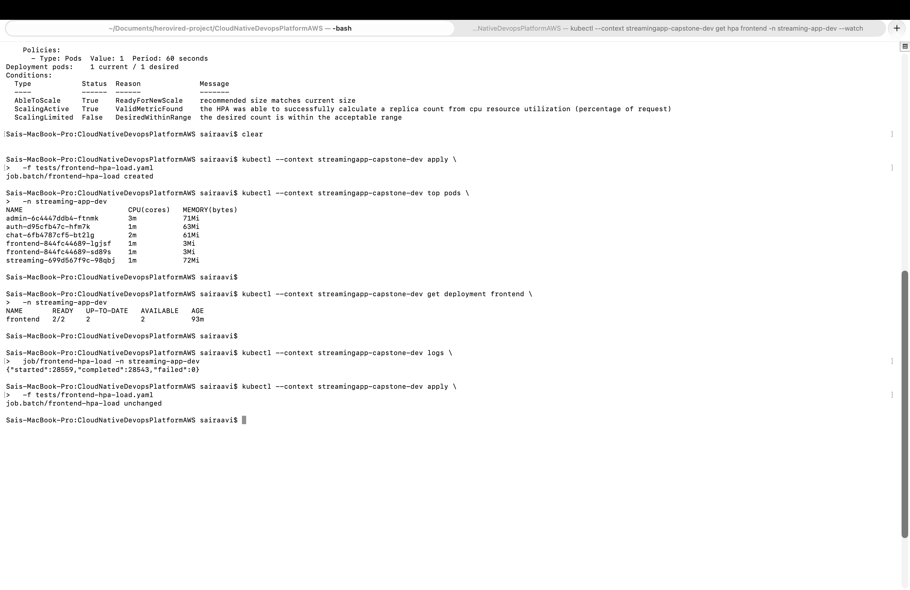

### 16. Install Cluster Autoscaler

Install autoscaler.

```bash
export CAPSTONE_AUTOSCALER_ROLE="$(terraform -chdir=Terraform/environments/dev output -raw autoscaler_role_arn)"
helm repo add autoscaler https://kubernetes.github.io/autoscaler
helm repo update autoscaler
helm upgrade --install cluster-autoscaler autoscaler/cluster-autoscaler \
  --version 9.59.0 --kube-context streamingapp-capstone-dev -n kube-system \
  -f Monitoring/cluster-autoscaler-values.yaml \
  --set-string awsRegion="$AWS_REGION" --set-string autoDiscovery.clusterName="$CAPSTONE_CLUSTER_NAME" \
  --set-string "rbac.serviceAccount.annotations.eks\.amazonaws\.com/role-arn=$CAPSTONE_AUTOSCALER_ROLE" \
  --set-string 'rbac.serviceAccount.annotations.eks\.amazonaws\.com/sts-regional-endpoints=true' \
  --wait --timeout 5m
kubectl --context streamingapp-capstone-dev logs deployment/cluster-autoscaler -n kube-system --tail=50
```

The values pin the autoscaler image to Kubernetes minor 1.36; do not rely on the chart's default app version. Annotations must render as YAML strings. Verify discovery and absence of access-denied errors before claiming autoscaling is operational.

### 17. Prepare monitoring passwords and install Prometheus/Grafana

Create the namespace, then create the Grafana admin Secret using a temporary private directory. These commands do not print the password:

Install monitoring.

```bash
kubectl --context streamingapp-capstone-dev create namespace monitoring --dry-run=client -o yaml |
  kubectl --context streamingapp-capstone-dev apply -f -
CAPSTONE_SECRET_DIR="$(mktemp -d)"
chmod 700 "$CAPSTONE_SECRET_DIR"
printf admin > "$CAPSTONE_SECRET_DIR/admin-user"
read -r -s -p 'Choose Grafana password: ' CAPSTONE_GRAFANA_PASSWORD
printf '\n'
printf '%s' "$CAPSTONE_GRAFANA_PASSWORD" > "$CAPSTONE_SECRET_DIR/admin-password"
chmod 600 "$CAPSTONE_SECRET_DIR/"*
kubectl --context streamingapp-capstone-dev create secret generic grafana-admin -n monitoring \
  --from-file=admin-user="$CAPSTONE_SECRET_DIR/admin-user" \
  --from-file=admin-password="$CAPSTONE_SECRET_DIR/admin-password" \
  --dry-run=client -o yaml | kubectl --context streamingapp-capstone-dev apply -f -
unset CAPSTONE_GRAFANA_PASSWORD
rm -r "$CAPSTONE_SECRET_DIR"
helm repo add prometheus-community https://prometheus-community.github.io/helm-charts
helm repo update prometheus-community
helm upgrade --install monitoring prometheus-community/kube-prometheus-stack \
  --version 92.16.1 --kube-context streamingapp-capstone-dev -n monitoring \
  -f Monitoring/kube-prometheus-stack-values.yaml \
  --set 'alertmanager.alertmanagerSpec.alertmanagerConfiguration=null' \
  --set 'prometheus.prometheusSpec.additionalScrapeConfigs=[]' \
  --wait --timeout 10m
kubectl --context streamingapp-capstone-dev get pods,pvc -n monitoring
```

The two initial overrides avoid referencing an email configuration that is not created yet or an old Jenkins private IP. Configure them in later steps. Expected: running pods and three Bound PVCs.

Open separate Mac terminals and keep each port-forward running:

Open a local monitoring tunnel.

```bash
kubectl --context streamingapp-capstone-dev port-forward -n monitoring service/monitoring-grafana 3000:80
```

Open a local monitoring tunnel.

```bash
kubectl --context streamingapp-capstone-dev port-forward -n monitoring service/monitoring-kube-prometheus-prometheus 9090:9090
```

Use `http://localhost:3000` for Grafana (choose 3005:80 if the local app uses 3000) and `http://localhost:9090` for Prometheus. Log in with the Grafana password just chosen. Open Kubernetes cluster/namespace resource dashboards. In Prometheus, run `up` and `up == 0`; inspect Targets. Save dashboard and target-health screenshots. Metrics-server is not a replacement for Prometheus historical monitoring.

### 18. Configure email alerts through SES

1. In SES in the same region, verify a sender domain using its DNS records and verify your recipient email if the account remains in the sandbox.
2. Create SES SMTP credentials and restrict their sending permissions. These are **SMTP credentials**, not your Outlook password.
3. Edit `Monitoring/alertmanager-email.yaml`: use your recipient, verified sender and regional SMTP hostname. Leave the `__SES_SMTP_USERNAME__` marker until rendering. `authUsername` is a string; `authPassword` is a Secret reference.
4. Create `monitoring/alertmanager-ses-smtp` with `username` and `password` keys privately. Use the temporary-file pattern from step 17, substituting these two filenames and Secret name. Do not commit the values.
Use this command sequence for step 4:

Store SMTP credentials privately.

```bash
CAPSTONE_SMTP_DIR="$(mktemp -d)"
chmod 700 "$CAPSTONE_SMTP_DIR"
read -r -s -p 'SES SMTP username: ' CAPSTONE_SMTP_USERNAME
printf '\n'
read -r -s -p 'SES SMTP password: ' CAPSTONE_SMTP_PASSWORD
printf '\n'
printf '%s' "$CAPSTONE_SMTP_USERNAME" > "$CAPSTONE_SMTP_DIR/username"
printf '%s' "$CAPSTONE_SMTP_PASSWORD" > "$CAPSTONE_SMTP_DIR/password"
chmod 600 "$CAPSTONE_SMTP_DIR/"*
kubectl --context streamingapp-capstone-dev create secret generic alertmanager-ses-smtp -n monitoring \
  --from-file=username="$CAPSTONE_SMTP_DIR/username" --from-file=password="$CAPSTONE_SMTP_DIR/password" \
  --dry-run=client -o yaml | kubectl --context streamingapp-capstone-dev apply -f -
unset CAPSTONE_SMTP_USERNAME CAPSTONE_SMTP_PASSWORD
rm -r "$CAPSTONE_SMTP_DIR"
```

5. Render the username from the Secret into the configuration and apply it without displaying credentials:

Configure routing and fire the test.

```bash
python3 - <<'PYSES'
import base64, json, pathlib, subprocess
base = ['kubectl', '--context', 'streamingapp-capstone-dev']
s = json.loads(subprocess.check_output(base + ['get', 'secret', 'alertmanager-ses-smtp', '-n', 'monitoring', '-o', 'json']))
u = base64.b64decode(s['data']['username']).decode()
text = pathlib.Path('Monitoring/alertmanager-email.yaml').read_text()
text = text.replace('"__SES_SMTP_USERNAME__"', json.dumps(u))
subprocess.run(base + ['apply', '-f', '-'], input=text, text=True, check=True)
PYSES
helm upgrade monitoring prometheus-community/kube-prometheus-stack \
  --version 92.16.1 --kube-context streamingapp-capstone-dev -n monitoring \
  --reuse-values --set-string alertmanager.alertmanagerSpec.alertmanagerConfiguration.name=capstone-email \
  --wait --timeout 10m
kubectl patch --local -f tests/monitoring-email-alert.yaml --type=json -p='[{"op":"replace","path":"/spec/groups/0/rules/0/expr","value":"vector(1) == 1"}]' -o yaml | kubectl --context streamingapp-capstone-dev -n monitoring apply -f -
```

Wait for the test alert to fire and arrive in the inbox. Confirm delivery rather than just a firing rule. Restore the inactive rule, wait for the resolved email, then remove the test rule:

Resolve and remove the test rule.

```bash
kubectl --context streamingapp-capstone-dev -n monitoring apply -f tests/monitoring-email-alert.yaml
```

Wait until the resolved notification arrives. Then remove the test rule:

```bash
kubectl --context streamingapp-capstone-dev -n monitoring delete -f tests/monitoring-email-alert.yaml
```

Capture firing and resolved emails. SES usage is billable subject to account allowances; do not assume it is free.

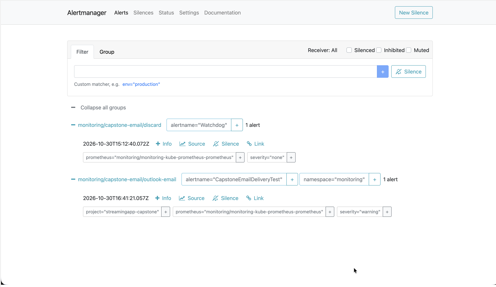

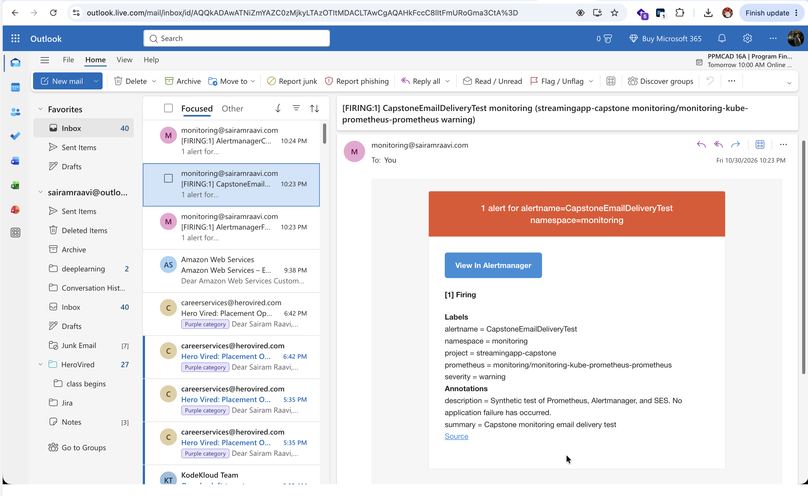

</details>

## 5. Release a change from GitHub

The Jenkins machine started as an Ubuntu host. Ansible installed its tools. We connected Jenkins to SonarQube, ran the job manually, and then connected GitHub’s webhook through Cloudflare Tunnel. A push now starts the job. Jenkins tests the code, checks the quality gate, builds the images, publishes them and updates dev. To trace a real request afterward, we looked up its unique marker in CloudWatch and checked the load balancer’s log files in S3.

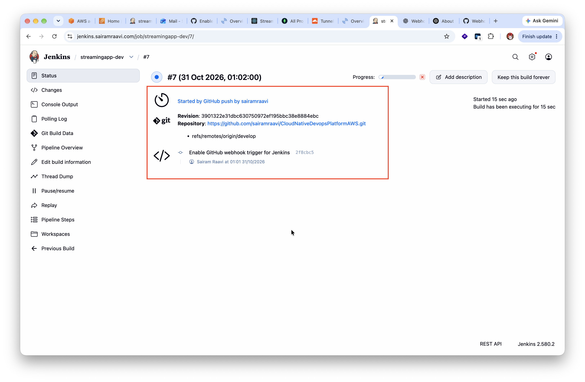

The build cause connects a GitHub push to the Jenkins run. The deployment check in the steps below identifies the images that reached EKS.

<details>
<summary>Show the setup steps for stage 5</summary>

### 19. Configure the Jenkins host through Ansible

**Mac, repository root:** refresh the current EC2 IP rather than reusing an earlier session's address.

Connect to the current Jenkins EC2.

```bash
export CAPSTONE_JENKINS_IP="$(terraform -chdir=Terraform/environments/dev output -raw jenkins_public_ip)"
ssh -i "$HOME/.ssh/streamingapp-capstone-jenkins" "ubuntu@$CAPSTONE_JENKINS_IP"
```

Confirm the host fingerprint using trusted EC2 information before accepting a new key. Exit back to the Mac. Customize `Ansible/roles/nginx/defaults/main.yml` for your Jenkins and SonarQube hostnames. Review version pins in `Ansible/group_vars/all/main.yml`.

Configure EC2 and verify Jenkins identity.

```bash
cd Ansible
ansible jenkins -m ansible.builtin.ping
ansible-playbook playbooks/jenkins.yml -e @group_vars/all/main.yml --syntax-check
ansible-playbook playbooks/jenkins.yml -e @group_vars/all/main.yml --skip-tags cloudflared
ansible jenkins -b --become-user=jenkins -m ansible.builtin.command -a 'docker ps'
ansible jenkins -b --become-user=jenkins -m ansible.builtin.command -a 'aws sts get-caller-identity --region ap-south-1'
cd ..
```

Cloudflared is deliberately deferred until a valid private token exists. Confirm the AWS identity is the Jenkins instance role. The host should not use copied SSO/static AWS credentials.

Open Jenkins through an SSH tunnel **from the Mac**, not inside EC2:

Leave this terminal open. Use a second terminal on the Mac for later commands.

```bash
ssh -i "$HOME/.ssh/streamingapp-capstone-jenkins" -N \
  -L 18080:127.0.0.1:8080 -L 19000:127.0.0.1:9000 "ubuntu@$CAPSTONE_JENKINS_IP"
```

Visit `http://127.0.0.1:18080`. For a fresh installation, obtain the initial admin password privately on EC2 using `sudo cat /var/lib/jenkins/secrets/initialAdminPassword`, finish the wizard and create an administrator. Never screenshot that password.

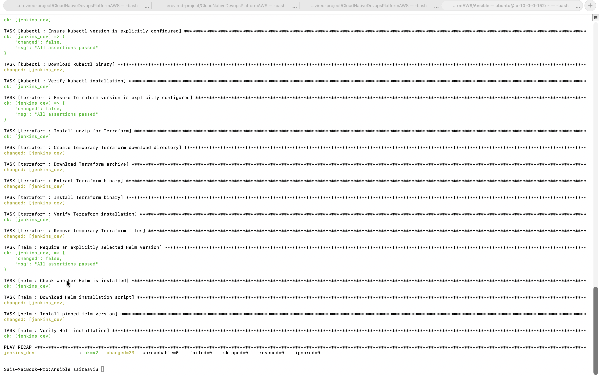

### 20. Give Jenkins its Kubernetes context

Configure Jenkins EKS access.

```bash
cd Ansible
ansible jenkins -b --become-user=jenkins -m ansible.builtin.command \
  -a 'aws eks update-kubeconfig --region ap-south-1 --name streamingapp-capstone-dev-eks --alias streamingapp-capstone-dev --kubeconfig /var/lib/jenkins/.kube/config'
ansible jenkins -b --become-user=jenkins -m ansible.builtin.command \
  -a 'kubectl --kubeconfig /var/lib/jenkins/.kube/config --context streamingapp-capstone-dev auth can-i patch deployments -n streaming-app-dev'
ansible jenkins -b --become-user=jenkins -m ansible.builtin.command \
  -a 'kubectl --kubeconfig /var/lib/jenkins/.kube/config --context streamingapp-capstone-dev auth can-i delete nodes'
cd ..
```

Expected: namespace deployment check says `yes`; node deletion says `no` (Ansible reports a nonzero result for this intentional negative test). The Terraform access policy and security-group rule must exist first. Capture this scoped-access proof.

### 21. Start SonarQube and configure the quality gate

Copy `Monitoring/sonarqube/compose.yaml` to `/opt/capstone-sonarqube/compose.yaml` on Jenkins EC2. Create a private `.env` there containing `POSTGRES_IMAGE`, `SONAR_IMAGE` and a strong `SONAR_DB_PASSWORD`. Use compatible, verified image versions/digests, not arbitrary latest tags. Preserve the same database major version when restoring an existing dump.

**Mac, repository root:** transfer the checked-in Compose file:

Transfer the Compose definition.

```bash
scp -i "$HOME/.ssh/streamingapp-capstone-jenkins" Monitoring/sonarqube/compose.yaml "ubuntu@$CAPSTONE_JENKINS_IP:/tmp/capstone-sonarqube-compose.yaml"
```

**Jenkins EC2:** create the directory and install the file:

On the Jenkins host, prepare the SonarQube directory.

```bash
sudo install -d -m 750 /opt/capstone-sonarqube
sudo install -m 640 /tmp/capstone-sonarqube-compose.yaml /opt/capstone-sonarqube/compose.yaml
sudo test -e /opt/capstone-sonarqube/.env || sudo install -m 600 /dev/null /opt/capstone-sonarqube/.env
sudo nano /opt/capstone-sonarqube/.env
```

Use the following format in the editor. Replace the placeholders with the selected image references and a password; do not run this as shell code.

```dotenv
POSTGRES_IMAGE=postgres@sha256:YOUR_VERIFIED_COMPATIBLE_DIGEST
SONAR_IMAGE=sonarqube@sha256:YOUR_VERIFIED_COMPATIBLE_DIGEST
SONAR_DB_PASSWORD=YOUR_PRIVATE_RANDOM_PASSWORD
```

**Jenkins EC2:**

On the Jenkins host, start SonarQube and verify status.

```bash
sudo chmod 600 /opt/capstone-sonarqube/.env
sudo sysctl -w vm.max_map_count=1048576
printf 'vm.max_map_count=1048576\n' | sudo tee /etc/sysctl.d/99-sonarqube.conf
sudo docker compose --project-directory /opt/capstone-sonarqube \
  --env-file /opt/capstone-sonarqube/.env -f /opt/capstone-sonarqube/compose.yaml up -d
curl --fail --silent --show-error http://127.0.0.1:9000/api/system/status
```

Wait for `UP`; a connection reset during startup is not itself proof of permanent failure. Use Compose logs if it does not become ready. The original compose limits require sufficient host memory.

Open `http://127.0.0.1:19000` through the Mac tunnel. Change the initial password, create project key `streamingapp-capstone` (matching `sonar-project.properties`), generate a project analysis token, and store it as a Jenkins Secret Text credential. In Jenkins install/configure the SonarQube Scanner integration:

- Server configuration name: `capstone-sonarqube`; URL from Jenkins: `http://127.0.0.1:9000`.
- Scanner tool name: `capstone-sonar-scanner`.
- Bind the token credential to the SonarQube server configuration.

The current project properties make the scanner wait for its quality gate. A restored SonarQube instance already containing the project does not need a duplicate project.

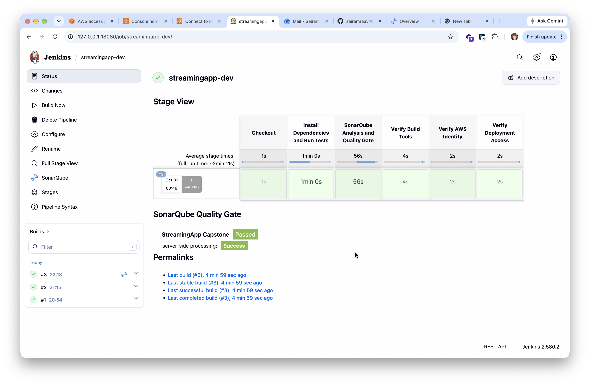

### 22. Configure and run the Jenkins pipeline

The Jenkinsfile compares the instance-role account against the configured dev cluster ARN, derives the ECR registry from the account and region, and reads the application hostname from the deployed Ingress. The job expects the dev cluster and namespace names used by this guide.

Install the Pipeline, Git, GitHub, SonarQube Scanner and Prometheus metrics plugins as required by the Jenkinsfile and monitoring. Create a Pipeline job:

1. Name: `streamingapp-dev`.
2. Definition: **Pipeline script from SCM**, SCM: Git.
3. Repository: your repository URL; use a read credential if private.
4. Branch specifier: the branch containing the Jenkinsfile, e.g. `*/develop` or `*/feature/capstone-end-to-end`.
5. Script path: `Jenkinsfile`.
6. Save and run the job. With DEPLOY_TO_DEV enabled, the root Jenkinsfile automatically promotes after dev verification. Complete the [staging preparation](delivery.md) first for an end-to-end run.

The first manual application installation in step 13 is required: the current pipeline uses `helm upgrade`, not first-install provisioning. Expected sequence: checkout → tests → SonarQube gate → tool/identity/access checks → build → ECR push → Helm upgrade → rollout/HTTPS checks. Save a successful full pipeline screenshot and quality-gate evidence. Do not treat only the initial verification stages as a completed deployment pipeline.

### 23. Configure Cloudflare Tunnel and the GitHub webhook

Create a Cloudflare Tunnel for this Jenkins host. Store its connector token privately at `/etc/cloudflared/token`, owned by root with mode 600. Do not paste token values into Git, screenshots, or chat. The role can alternatively receive `vault_cloudflared_tunnel_token` from an encrypted Ansible Vault file.

In Cloudflare configure public hostnames:

| Hostname | Origin on EC2 |
| --- | --- |
| Your Jenkins hostname | `http://127.0.0.1:8081` |
| Your SonarQube hostname | `http://127.0.0.1:8082` |

The two nginx listeners are loopback-only. Jenkins metrics use the **private EC2 IP** on port 8082; this is a different listening address from SonarQube's loopback port.

**Mac:**

Configure the tunnel service.

```bash
cd Ansible
ansible-playbook playbooks/jenkins.yml -e @group_vars/all/main.yml --tags cloudflared
cd ..
```

Verify the tunnel is healthy and both URLs load. Restrict dashboard access through Cloudflare Access and application authorization. Configure the exact `/github-webhook/` path so GitHub can reach it without an interactive Access login; retain POST-only handling and configure webhook secret verification in Jenkins/GitHub. Do not bypass access control for the entire hostname.

In GitHub repository Settings → Webhooks add `https://YOUR_JENKINS_HOST/github-webhook/`, JSON content type, SSL verification enabled and push events. Confirm delivery succeeds, then push an intended commit and verify an automatic successful build. Save webhook delivery and automatically triggered build evidence.


### 24. Connect Jenkins metrics to Prometheus

Verify the Prometheus plugin endpoint on **Jenkins EC2**:

On the Jenkins host, verify local metrics and nginx.

```bash
curl --fail --silent --show-error http://127.0.0.1:8080/prometheus/ | head
sudo nginx -t
```

Get the current private address from Terraform on the Mac:

Read current Jenkins private IP.

```bash
CAPSTONE_JENKINS_PRIVATE_IP="$(terraform -chdir=Terraform/environments/dev output -raw jenkins_private_ip)"
```

Use the current Jenkins private IP plus port 8082 as the scrape target. Ensure the Terraform security-group rule permits the intended monitoring source. Reapply the complete values file now that `capstone-email` exists:

Update the Jenkins scrape target.

```bash
helm upgrade monitoring prometheus-community/kube-prometheus-stack \
  --version 92.16.1 --kube-context streamingapp-capstone-dev -n monitoring \
  -f Monitoring/kube-prometheus-stack-values.yaml \
  --set-string "prometheus.prometheusSpec.additionalScrapeConfigs[0].static_configs[0].targets[0]=$CAPSTONE_JENKINS_PRIVATE_IP:8082" --wait --timeout 10m
```

Query `up{job="jenkins"}` in Prometheus; expected value is 1. Import `Monitoring/dashboards/jenkins-monitoring.json` into Grafana and select the Prometheus data source. Capture a populated dashboard, not an empty one.

### 25. Verify CloudWatch application and Jenkins logs

Terraform creates log groups and IAM access. Ansible installs/configures the Jenkins CloudWatch agent. For application logs, install Fluent Bit with the role from this deployment:

Inspect logging role and chart.

```bash
export CAPSTONE_LOG_ROLE="$(terraform -chdir=Terraform/environments/dev output -raw application_logs_role_arn)"
helm repo add fluent https://fluent.github.io/helm-charts
helm repo update fluent
helm search repo fluent/fluent-bit --versions | head
```

Select and record a compatible chart version, replacing the placeholder:

Install log collector and inspect delivery.

```bash
export FLUENT_BIT_CHART_VERSION='REPLACE_WITH_SELECTED_VERSION'
helm upgrade --install fluent-bit fluent/fluent-bit \
  --version "$FLUENT_BIT_CHART_VERSION" --kube-context streamingapp-capstone-dev \
  -n monitoring -f Monitoring/cloudwatch/fluent-bit-values.yaml \
  --set-string "serviceAccount.annotations.eks\.amazonaws\.com/role-arn=$CAPSTONE_LOG_ROLE" \
  --wait --timeout 5m
aws logs tail /streamingapp-capstone/dev/application --since 1h --format short
aws logs tail /streamingapp-capstone/dev/jenkins --since 1h --format short
```

The Fluent Bit input/output config and Jenkins agent JSON currently specify the dev namespace and Mumbai region; change them together if deploying elsewhere. Confirm the logging IAM trust matches `monitoring/fluent-bit` before installing.

If Jenkins logs are empty, on **EC2**, inspect `sudo journalctl -u jenkins.service` and `/opt/aws/amazon-cloudwatch-agent/logs/amazon-cloudwatch-agent.log`. The latter path does not exist on your Mac. Verify newly emitted Jenkins messages arrive; an active agent alone does not prove delivery. Capture application and Jenkins log records (historical screenshots 67 and 68).

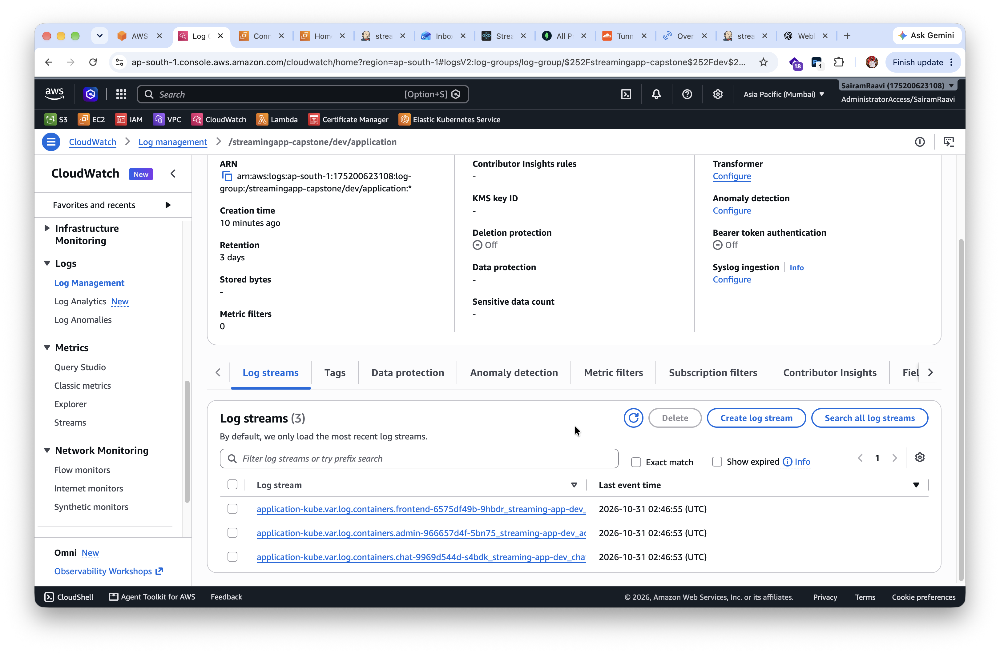

### 26. Enable ALB access logs

The persistent root creates a private log bucket with a delivery policy and three-day expiration. Preserve the existing idle-timeout attribute while adding access-log attributes:

Enable ALB request logging.

```bash
helm upgrade streamingapp helm/streamingapp \
  --kube-context streamingapp-capstone-dev -n streaming-app-dev --reuse-values \
  --set-string "ingress.loadBalancerAttributes=idle_timeout.timeout_seconds=120\,access_logs.s3.enabled=true\,access_logs.s3.bucket=$CAPSTONE_ALB_LOG_BUCKET\,access_logs.s3.prefix=alb" \
  --wait --timeout 10m
curl --fail --silent --show-error -o /dev/null "https://$APP_DOMAIN/"
aws s3 ls "s3://$CAPSTONE_ALB_LOG_BUCKET/alb/AWSLogs/$CAPSTONE_ACCOUNT_ID/" --recursive
```

Delivery is asynchronous. Verify actual log objects after allowing time, not just the bucket existence or test file. Capture delivered access-log evidence (historical screenshot 69).

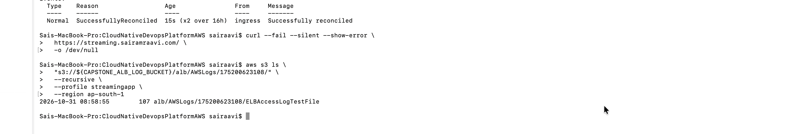

</details>

## 6. Save the installation and prove it can come back

Before removing dev, we saved Jenkins jobs and credentials, the SonarQube database, extensions and private host configuration. We checked all four archives after transfer. During recreation the cluster and host addresses changed, so we refreshed DNS, Atlas access and the Jenkins connection. The practical test was opening a previously uploaded video on the rebuilt site.

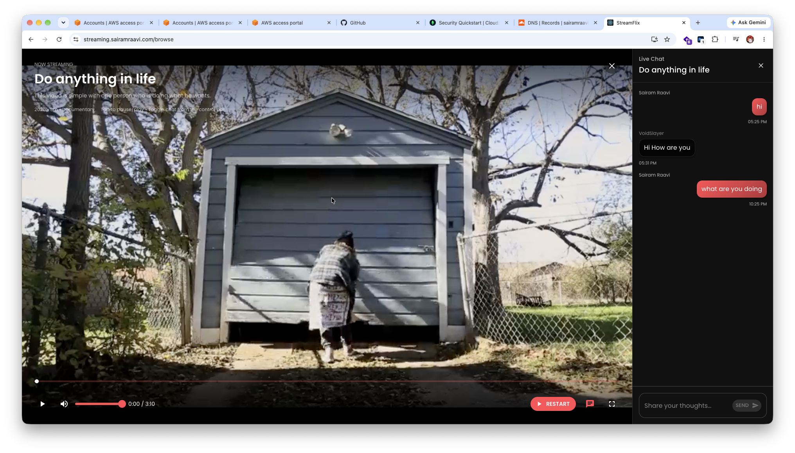

Playback worked after recreation. Database disaster recovery still needs its own isolated restore test.

<details>
<summary>Show the setup steps for stage 6</summary>

### 27. Preserve configuration and back up before teardown

Commit reviewed infrastructure, Ansible roles, chart values, pipeline and documentation changes. Keep credentials and backup archives private. The repository contains configuration automation; it does not yet contain a fully verified unattended backup-and-restore system.

To create a fresh backup on the established dev environment, follow step 1 of the [dev lifecycle guide](dev-lifecycle.md), then run `python3 scripts/dev-session.py checkpoint` from the repository root. Keep the checkpoint directory it prints. The host backup contains:

| File | Preserves |
| --- | --- |
| `jenkins-home.tar.gz` | Jenkins home, including jobs, plugins and credential-encryption material |
| `sonarqube.dump` | PostgreSQL logical dump for SonarQube |
| `sonarqube-extensions.tar.gz` | SonarQube extensions |
| `host-private-config.tar.gz` | Private host configuration and secrets included during backup |
| `SHA256SUMS` | Integrity manifest |

A directory with only the first two files is **incomplete**. Backups contain credentials and must be protected. Stop writes while taking consistent Jenkins/extension backups; use PostgreSQL backup tooling for its database. A live archive of PostgreSQL volume files is not a substitute for a consistent database backup.

After copying the complete backup to a private Mac location, verify **inside that directory**, not the repository:

Verify all four backup checksums.

```bash
cd /absolute/path/to/your/private/capstone-backup-directory
shasum -a 256 -c SHA256SUMS
```

Expected: all four archives report OK. Checksum success proves transfer integrity, not restore success. A new host restoration must still validate Jenkins ownership, compatible SonarQube/PostgreSQL versions, credentials, current kubeconfig, tunnel token and changed network addresses. Preserve Grafana dashboard JSON separately if its PVC will be deleted.

If restarting SonarQube after backup, use explicit paths so a changed working directory cannot break startup. **EC2:**

On the Jenkins host, restart backed-up services.

```bash
sudo systemctl start jenkins
sudo docker compose --project-directory /opt/capstone-sonarqube \
  --env-file /opt/capstone-sonarqube/.env -f /opt/capstone-sonarqube/compose.yaml start sonarqube
curl --fail --silent --show-error http://127.0.0.1:9000/api/system/status
```

### 28. Tear down only the development session

This step deletes the application and monitoring data in the development cluster and destroys Jenkins EC2. Complete private backups first. Keep the load-balancer controller and EBS CSI running until their managed resources have been removed. Never run blanket account-wide deletion commands in a shared lab account.

**Mac, repository root:**

Remove app and monitoring releases.

```bash
export CAPSTONE_VPC_ID="$(terraform -chdir=Terraform/environments/dev output -raw vpc_id)"
kubectl --context streamingapp-capstone-dev get pv \
  -o 'custom-columns=PV:.metadata.name,VOLUME:.spec.csi.volumeHandle,RECLAIM:.spec.persistentVolumeReclaimPolicy'
helm uninstall streamingapp --kube-context streamingapp-capstone-dev -n streaming-app-dev --wait --timeout 10m
aws elbv2 describe-load-balancers \
  --query "LoadBalancers[?VpcId=='${CAPSTONE_VPC_ID}'].{Name:LoadBalancerName,State:State.Code}" --output table
helm uninstall monitoring --kube-context streamingapp-capstone-dev -n monitoring --wait --timeout 10m
kubectl --context streamingapp-capstone-dev get pvc -n monitoring
```

Wait for the ALB to disappear. After confirming you accept loss of the remaining monitoring volumes:

Delete monitoring storage and plan teardown.

```bash
kubectl --context streamingapp-capstone-dev delete pvc --all -n monitoring --wait=true --timeout=5m
kubectl --context streamingapp-capstone-dev get pv
terraform -chdir=Terraform/environments/dev plan -destroy -input=false -out=destroy-dev.tfplan
```

Review the destroy plan and ensure it is the **dev** root, then:

Destroy reviewed dev resources.

```bash
terraform -chdir=Terraform/environments/dev apply destroy-dev.tfplan
terraform -chdir=Terraform/environments/dev state list
```

Expected: empty dev state. Check the previously recorded EBS volume IDs in EC2 and verify that project NAT gateways, ALB and EC2 instances are gone. An empty state is not proof that every out-of-band resource was deleted. Preserve bootstrap/persistent resources, Atlas data and private backups. Remove obsolete DNS/NAT allow-list entries. Capture teardown evidence (historical screenshot 70).

### 29. Resume after a teardown

For the working dev environment, use the [single-command dev lifecycle](dev-lifecycle.md) for future sessions. Its `down` command captures the current settings before deletion; its `up` command consumes that checkpoint. The following manual path also applies to older teardowns without a lifecycle checkpoint.

1. Log in again and repeat the session exports in step 2.
2. Verify the private backup checksums and existing bootstrap/persistent plans.
3. Refresh Terraform outputs from step 5; do not create duplicate persistent resources.
4. Supply current administrator IP, SSH key, admin role and AMI inputs in step 9.
5. Recreate dev infrastructure, then update Atlas with new NAT IPs.
6. Reinstall controllers, secrets and application using the recorded release image tag, or rebuild all images intentionally.
7. Update application DNS to the new ALB; update Jenkins inventory through `CAPSTONE_JENKINS_IP` and the monitoring private-IP target.
8. Recreate monitoring credentials/configuration. Use the recovery command below to restore the Jenkins EC2 tools and refresh Jenkins’ kubeconfig.
9. Verify login, upload/playback, chat, pipeline, alert delivery and logs before calling recovery complete.

Do not reuse a saved Terraform plan from before teardown, an old ALB hostname or an old IP address.

### Restore the dev Jenkins and SonarQube host

After Terraform recreates the dev host, sign in with the intended AWS profile. Verify its SSH host fingerprint and accept it once as in step 19. From the repository root on your Mac, run:

Restore dev tooling.

```bash
export AWS_PROFILE=streamingapp
export AWS_REGION=ap-south-1
./scripts/recover-dev-tools.sh "$HOME/PrivateBackups/capstone/capstone-backup-20261031T074819Z"
```

Use your private backup directory containing the four archives and their checksum manifest. The command reads the current Jenkins IP and EKS name from Terraform, provisions tools through Ansible, transfers the backup over SSH, verifies it, and restores the existing Cloudflare token and SonarQube Compose settings. It refreshes Jenkins’ private kubeconfig using the EC2 instance role.

The restore expects the capstone backup layout: Jenkins under `jenkins/`, extensions relative to their volume root, and the private files at `etc/cloudflared/token`, `opt/capstone-sonarqube/compose.yaml` and `opt/capstone-sonarqube/.env`. The previous Jenkins home is preserved during a fresh restore. A rerun keeps an existing capstone job, populated SonarQube database and nonempty private config files. Use a trusted, verified backup. The remote private copy occupies space under `/var/backups/capstone-recovery`.

The playbook waits for Jenkins login through nginx on port 8081 and for SonarQube to return JSON status `UP` through nginx on port 8082. A SonarQube HTTP 200 with status `STARTING` keeps the check running. On a new host the connector starts after these checks. Keep the existing published Cloudflare routes, Access policy and a valid connector token. After the play succeeds, sign in through each public URL and confirm the Jenkins build history and previous SonarQube project analysis. If the SonarQube wait times out, inspect `sudo docker compose logs --tail=80 sonarqube db` from `/opt/capstone-sonarqube` on EC2. Leave the database volume in place while diagnosing startup.

</details>

## 7. Promote the same release to staging

Staging has its own cluster, namespace, hostname, certificate, database credentials and media bucket. Create these with the [combined setup](setup-dev-stage-prod.md). If you already created the staging Terraform resources by hand, use the workstation scripts below from the repository root with that account's staging backend and private inputs configured. The preparation script reads the saved staging workloads plan, checks the allowed changes and applies them automatically. That historical script assumes the original staging hostname. For another domain, use the combined runner and its private configuration.

```bash
bash scripts/staging/verify-foundation.sh
bash scripts/staging/sync-application-secret.sh
bash scripts/staging/prepare-promotion.sh
```

Look for ready nodes in two zones, an issued certificate and Ready conditions for both secret resources. The preparation script gives Jenkins the deployment access and Helm settings it will use.

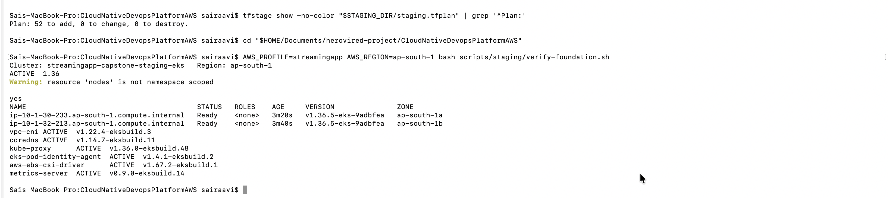

### Check what was promoted

Use the same Jenkins job. With **DEPLOY_TO_DEV** selected, the job deploys to dev and automatically enters **Promote to Staging** after dev passes. Clearing the box skips deployment. The [promotion script](../scripts/staging/promote.sh) resolves each ECR image to its digest, installs or upgrades the staging release, and checks all five deployments.

Using your staging kubeconfig, run:

```bash
kubectl --context streamingapp-capstone-staging -n streaming-app-stg get deployments -o 'custom-columns=SERVICE:.metadata.name,READY:.status.readyReplicas,IMAGE:.spec.template.spec.containers[0].image'
```

Look for ready replicas in **every** row and the five expected image digests. Then use the staging website to log in, upload a test video, play it and chat from two browsers. During the recorded attempt the frontend started, but four backends failed to log in to Atlas. A synchronized Kubernetes secret only tells you that the secret was copied. Confirm the database user, password encoding, database permissions and current NAT access entries before rerunning.

### Decide when to release production

Record the staging-tested digests, test results and deployed-image scan findings. Have the release owner review those results, confirm a rollback release and test a database restore before sending users to production. See the [production planning scripts](../scripts/prod/README.md) and [operator-run setup](setup-dev-stage-prod.md). The root Jenkins job ends at staging. A completed production approval, rollout and rollback still need a live demonstration.


## Repeat the setup automatically

Use this after you have the project's private inputs and a verified Jenkins/SonarQube backup. If this is your first installation and you have no backup, start with the [first-time guide](setup-process.md). The runner restores the existing Jenkins job, credentials and tunnel. A fresh clone cannot supply those private files.

### 1. Prepare the workstation

Open the repository root on the Mac. Use the account where you want to create **all three** environments. This can start three EKS control planes, worker groups, NAT gateways, load balancers and a Jenkins instance. Check your account quotas and available budget before deployment.

Install Python 3.9+, AWS CLI, Terraform, Helm 4, kubectl, Atlas CLI, Ansible, SSH, curl and shasum. If you will build missing images, start Docker with Buildx. Sign in to AWS and Atlas. Check the account number:

```bash
aws sts get-caller-identity --profile streamingapp --query Account --output text
python3 scripts/platform.py outline
```

### 2. Fill in one private configuration file

```bash
mkdir -p -m 700 "$HOME/.capstone-inputs"
cp -n scripts/platform.example.json "$HOME/.capstone-inputs/platform.json"
chmod 600 "$HOME/.capstone-inputs/platform.json"
```

Open that copy in an editor. Use the [example](../scripts/platform.example.json) for the exact field names.

| Fill in | Where to get it |
| --- | --- |
| Account, region, zones, admin role, current public IPv4 with /32, Ubuntu amd64 AMI | Your AWS account and [cluster preparation](03-cluster-and-application.md). Keep the Jenkins SSH key pair in ~/.ssh under the name streamingapp-capstone-jenkins. |
| State bucket | Use the existing bucket for that account. Only for a brand-new bootstrap, remove the state_bucket field and set new_account to true. |
| Cloudflare zone and three distinct hostnames | Your domain's Cloudflare settings. Export CLOUDFLARE_API_TOKEN privately with permission to manage DNS in that zone. For an existing traffic record, supply previous_cname only after verifying its old target. |
| Atlas project, application credentials and Grafana password for each environment | Create separate database users with access to their own database. Each application JSON file needs MONGO_URI and JWT_SECRET. Each Grafana file holds its password as plain text. Restrict the files to mode 600. Authenticate Atlas CLI with access-list permissions. |
| SMTP file, sender and recipient | Use the SES SMTP username and password for the deployment region. Store them under username and password in a private JSON file. Complete SES identity verification first. |
| Jenkins backup directory | Use the directory with four archives and SHA256SUMS from [chapter 6](06-backup-and-rebuild.md). Keep the webhook, tunnel and Access settings aligned with this backup. Pause incoming builds during setup. |
| Release tag and Fluent Bit chart version | Use an approved tag present in all five ECR repositories and the tested chart version. To build missing images, enable build_missing_images and set source_commit to the exact checked-out commit. Use a clean application tree and a fresh tag. |

### 3. Preview, then create the environments

```bash
python3 scripts/platform.py plan "$HOME/.capstone-inputs/platform.json"
```

Read the account and planned resources. On a new account some plans will be deferred until the previous step creates its outputs. When you are ready, run:

```bash
python3 scripts/platform.py up "$HOME/.capstone-inputs/platform.json"
```

The runner creates the state and retained resources, brings up dev and restores Jenkins, then provisions staging and production. In each cluster it connects secrets and Atlas, installs the controllers, deploys the app, connects DNS and sets up monitoring and email routing. Dev also gets application log forwarding, ALB access logs and Jenkins monitoring. A current secret version is preserved; changing a local file alone will not rotate an existing secret.

### 4. Check the result before accepting a release

The runner waits for five deployment rollouts and checks the public featured-video API in each environment. Open each hostname, sign in and play a video. Check upload, two-user chat, dashboards and an alert email. The workstation command provisions production; the regular Jenkins push workflow promotes through staging. The combined live setup and recovery drill still needs verification.

If a step fails, keep the same configuration, fix the reported dependency and rerun. Terraform state and Helm releases let the runner pick up existing resources. Keep the private metadata under ~/.capstone/ACCOUNT/REGION/platform. When you finish, follow [teardown and recovery](teardown-end-to-end.md).


## When you finish

For a development session use the checkpoint and recovery procedure in stage 6. To retire all three running environments, follow the [end-to-end teardown procedure](teardown-end-to-end.md). It explains which storage and backups remain after the clusters disappear.
