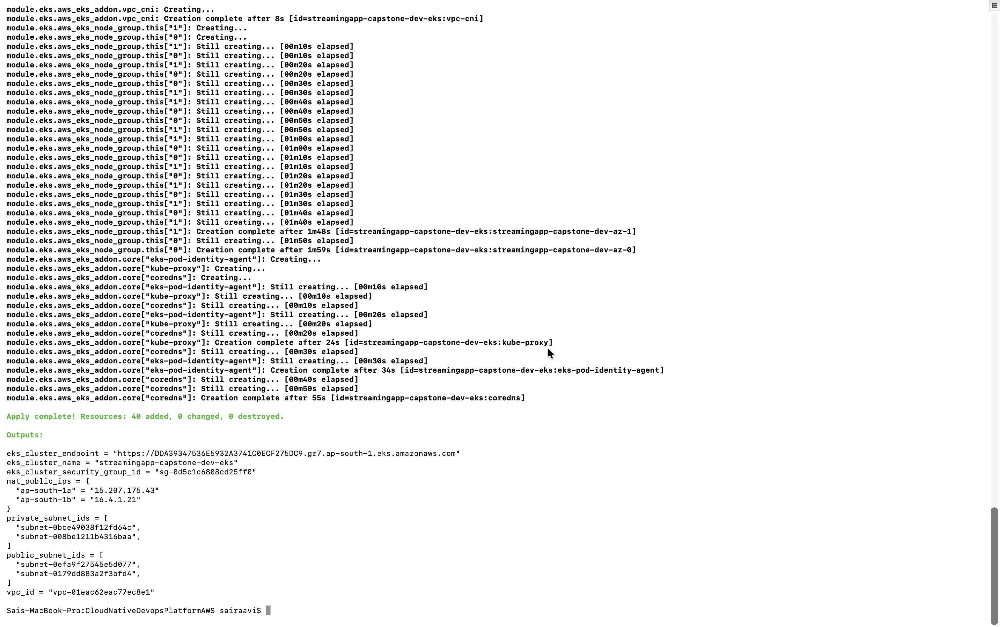

# AWS infrastructure and state ownership

**Implemented and verified:** bootstrap, persistent and dev stacks in Mumbai. **Partially implemented:** staging application environment. The [production planning guide](../scripts/prod/README.md) covers the proposed cluster and retained data roots; live production validation is pending. The [operator runbook](../Docs/setup-process.md) contains the initialization, variable exports, plan/apply steps and verification commands.

| Terraform root | Ownership and dependency |
| --- | --- |
| [bootstrap](bootstrap/) | Creates the state bucket, public access block, ownership controls, encryption, transport policy and versioning. Bootstrap starts with local state, then migrates it. The S3 backend uses a lockfile. |
| [persistent](persistent/) | Owns the ACM certificate, application secret metadata, private media and ALB log buckets and five ECR repositories and retention policies. DNS validation and populating secret values happen outside that root. |
| [environments/dev](environments/dev/) | VPC in two zones, public and private routing, NAT, EKS and managed node groups, add-ons, Jenkins EC2, workload IAM, CloudWatch and deployment access. Uses retained bucket/secret identifiers. |
| [staging-data](staging-data/) | Separate certificate, media/CORS and secret for the staging application. Requires its own validation CNAME and database identity. |
| [environments/staging](environments/staging/) | Separate VPC and EKS, cluster add-ons, service roles, Jenkins API access and namespace-scoped authorization. Depends on the dev Jenkins role and running instance. |

In the personal account, bootstrap created six resources, persistent created 25 and dev created 77. A follow-up bootstrap plan reported no changes. These counts describe a recorded apply. The reusable [networking](modules/networking/), [EKS](modules/eks/) and [ECR](modules/ecr/) implementations determine future plans. Dev and staging use distinct state keys and inputs rather than a shared workspace switched between environments.

## Trust boundaries and account migration

1. On the workstation, authenticate the streamingapp profile and verify account and region. The lab used SSO; the personal account used a separate login and assumable EKS administrator role. A historical root identity check is evidence of account setup. Use short-lived role credentials for routine operation.
2. Keep backend metadata, variable files and saved plans private and separate by account, region and root. Initialize a new personal-account state bucket and repositories; restore data or rebuild images explicitly. An old account's image URL, certificate, endpoint or state cannot identify resources in the new account.
3. Jenkins uses the EC2 instance profile for ECR and EKS API calls. Kubernetes EKS access entries restrict its authorization by namespace. Admin/streaming use service-account roles for media; External Secrets assumes a separate secret-reader role. Trust depends on the issuer, namespace and service-account name.
4. Validate the operator identity and cluster context, list nodes, inspect enabled add-ons and exercise the Jenkins role as the Jenkins user. Distinguish network reachability, AWS authentication and Kubernetes authorization when diagnosing failures.

See [lifecycle and retained charges](../Docs/dev-lifecycle.md) before removing dev. The state bucket and persistent data are recovery dependencies.
